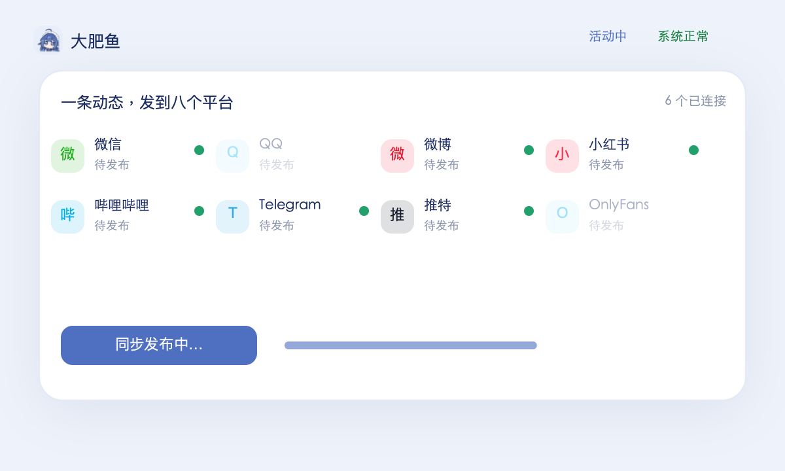

# Fish Harness

[](https://github.com/hansei996/fish-harness/actions/workflows/verify.yml)

**在 [DeepSeek Harness](https://github.com/deepseek-ai/deepseek-harness) 之上，给一个 Agent 一条能长期活下去的命。**

dsh 给 Agent 一个会话。这个东西给它一段**跨会话活着**的生命：有身份、有兴趣、有承诺、有账本，还有**自己的作息**——没人说话的时候，它到点会自己醒。

> **Harness 是产品，鱼是它在运行时的样子。**
>
> 🌐 **[对外页面](https://hansei996.github.io/fish-harness/)** —— 给不读代码的人看的版本
>
> 「养鱼」是抽象说法 —— 让 Agent 在 Harness 上长期稳定运行。鱼是运行态，不是产品本身。

---

## 目录

| 路径 | 是什么 |
| --- | --- |
| [`packages/dsh-life/`](packages/dsh-life/) | **要做的产品**：dsh 插件，生命层 |
| [`tools/`](tools/) | 四个工具：`day-report` 把账本渲染成人能读的「它的一天」；`life-week` 把七天压缩跑完，产出「它的一周」；`demo-data` 把那一周导出成对外页面引用的数据；`facts` 量出文档里不许手抄的那些数字 |
<!-- facts:verify-summary -->
| [`verify/`](verify/) | 十套共 **235 项**；另有一条 opt-in 的真实唤醒检查（3 项） |
<!-- /facts:verify-summary -->
| [`design/`](design/) | 界面原型与技术架构图（单文件 HTML，直接打开） |
| [`docs/PLAN.md`](docs/PLAN.md) | 规划 v0.5（当前）· `v0.1` / `v0.2` / `v0.3` / `v0.4` 保留在旁，可对照错在哪 |
| [`docs/PRODUCT.md`](docs/PRODUCT.md) | **产品规划**：市场位置、竞争分析、分阶段对外策略 |
| [`docs/MARKET.md`](docs/MARKET.md) | **市场调研**：我们不在哪两个市场、分层对标（带可复跑的星数/下载量）、能力矩阵、三档用户与证伪条件、定价基准 |
| [`docs/STORY.md`](docs/STORY.md) | **叙事**：软件史的下一次变化、三个落地场景、不声称什么 |
| [`docs/index.html`](docs/index.html) | **对外页面**：单页静态站点，GitHub Pages 直接从 `docs/` 发布 |
| [`docs/scenarios.html`](docs/scenarios.html) | **三个落地场景的详版原型**：4 幕 × 6 拍，可点走，每拍标「已实现 / 设想」 |
| [`docs/dsh-schedule-api.md`](docs/dsh-schedule-api.md) | dsh `schedule` 的可落地 API 结论（带 `包名/文件:行号` 证据） |
| [`docs/life-week.md`](docs/life-week.md) | 一份真实跑出来的七天日志，以及它**没**证明什么 |
| [`docs/wake-verification.md`](docs/wake-verification.md) | 自主唤醒验了什么、**没验什么** |
| [`docs/wake-e2e.md`](docs/wake-e2e.md) | 真实 web profile 下一次真实唤醒的实测记录 |
| [`docs/ci.md`](docs/ci.md) | CI 的固定项与理由 |
<!-- facts:verify-workflow -->
| [`.github/workflows/verify.yml`](.github/workflows/verify.yml) | ubuntu + windows 各跑一遍十套 verify（smoke / day-report / demo-data / life-week / ui / publish / e2e / pack / landing / market） |
<!-- /facts:verify-workflow -->

---

## 一句话说清它补的是什么

dsh 已经开源并且自带：会话持久化与崩溃恢复、持久目标（`goal`）、Host 级定时（`schedule`）、后台作业（`jobs`）、逐次批准（`approval`）、进程隔离（`sandbox`）、提示词装配（`system-prompt`）、工具注册表（`tools`）。

它自己的架构文档写着：**there is no privileged core to patch**。

所以这个仓库**不重写任何一项**。它只补 dsh 没有的那个概念：**活过一次会话的状态**。

| 关注点 | 谁负责 |
| --- | --- |
| 会话不丢 · 崩溃恢复 · 事件可重放 | **dsh** |
| 进程隔离 · 工具权限 · 失败关闭 | **dsh** |
| 用户批准 · 审计事件 | **dsh** |
| 持久定时器（到点把消息投回会话） | **dsh `schedule`** |
| 上下文压缩 · 模型切换适配 | **dsh** |
| **唤醒策略**（抖动 · 静默时段 · 每日预算 · 醒来后做什么） | 我们 |
| **生命状态一致性**（身份不许被一次网页注入改写） | 我们 |
| **活动选择**（此刻做什么） | 我们 |
| **外部副作用幂等**（发帖不重复） | 我们 |
| **预算硬上限与休眠** | 我们 |
| **长期行为回归**（养 30 天后还是同一个它） | 我们 |

左列每一行，都是我们**明确决定不写的代码**。规划 v0.2 曾经把这些设计成自己的护城河 —— 那等于把别人的基础设施重写一遍。

自主唤醒是这条原则的样板：dsh 的 `schedule` 只给你一个持久定时器，`ScheduleCreateRequest` 里**没有** jitter、免打扰、每日预算，也没有 onFire 回调。所以我们写的是**策略**（`lib/wake.js`，159 行纯函数），不是第二套调度器——代码里没有一个 `setInterval`。

---

## Showcase

三个视频，**都由 PAGX 逐帧烘焙生成**（不是录屏）。

### 一、产品本身：六幕


> 31 秒、30fps。第 1 天（它什么都没有）→ 它现在在做什么 → 生活账本与因果链 → 一条动态发到八个平台 → 两条状态轴与故障收场 → 桌宠形态。
> 高画质版本：[`showcase/demo.mp4`](showcase/demo.mp4)

| | |
| --- | --- |
|  |  |
| **它现在在做什么** — 有界的当前活动：为什么是这件事、存档证据、进度与上限、下一步想做什么 | **一条动态发到八个平台** — 逐渠道开关（这里关掉 QQ 与 OnlyFans）、同步发布、逐条回执 |
|  | |
| **桌宠形态** — 浮在桌面一角，气泡说话；「回它 / 别烦我」 | |

> 另几幕（生活账本与因果链、两条状态轴、第 1 天）只在视频里，因为它们是动画。

### 二、三个落地场景


> 29 秒、四幕，对应 [`docs/STORY.md`](docs/STORY.md) 里的三个场景。
> 高画质版本：[`showcase/scenarios.mp4`](showcase/scenarios.mp4)

**每一幕都是两拍**，因为「展示价值」需要两拍：第 1 拍看**它在做什么**，第 2 拍看**所以值什么** ——
也就是「这个位置换成一个更好的工具会怎样」。只演第 1 拍，观众会想「挺有意思」；只演第 2 拍，观众会想「凭什么」。

| 场景 | 第 1 拍：它做什么 | 第 2 拍：换成更好的工具会怎样 |
| --- | --- | --- |
| **一个垂类，一年的真实踩坑史** | 五次尝试的日志：两次失败、一次重读手册、第 4 次才通，末尾标「有工具证据」 | 换成更快的写手：写得更多，但没人读第二篇 —— **要的是「真的试过」，不是「更多」**。一年约 260 次真实尝试 |
| **小团队缺测试，而它有耐心** | 同一场游玩，对外是记录，对内是结构化卡关数据（第 3 关、37 局里出现 9 次、可复现） | 换成雇人测：三个人挤时间，第二周就疲了，开始说「这个我测过了」而其实没复现。**它每天 3 小时、一天不落** |
| **开源项目共养一个记得事的成员** | 三个月前否掉方案 B（因为构建时间），今天有人再提，**它记得** | 换成再好的机器人：只记得这次对话，下次从零开始 —— **同一个方案会被否掉两次** |

**第四幕是诚实的一页**：对着仓库逐条核过 —— 哪些已实现、哪些没有。不写这一幕，前三幕就成了「它已经在这样生活」的暗示。

> ⚠️ **三个场景是设想，不是演示已有功能。** 生命层、自主唤醒、活动选择、证据规则都已实现并验证；
> 但**对外发布尚未实现**。所以画面里它「发了内容」的部分，目前停在草稿。
>
> **想要更细的版本，看原型**：[`docs/scenarios.html`](docs/scenarios.html)（浏览器直接打开，也已发布到线上）。
> 4 幕 × 6 拍、可点走，比视频密得多，而且**改一行就能重看** —— 每一拍还标了它靠什么成立：
> 绿色是仓库里已经跑得起来的（附文件名），amber 是还没实现的。**没标出来就等于假装这些场景已经能跑。**

### 三、它的一周：七天之后，它还是同一个它吗


> 19 秒、四幕。高画质版本：[`showcase/oneweek.mp4`](showcase/oneweek.mp4)

| 幕 | 它讲什么 |
| --- | --- |
| **第 1 天 · 一次失败** | 10:29 没做成，留下证据；失败没有变成空白，而是变成一条留给明天的事 |
| **第 2 天 · 它接着昨天** | 醒来先读自己的状态：昨天的下一步、昨天长上去的兴趣。**这条不在提示词里，在磁盘上** |
| **7 天 · 兴趣长这样** | 0.55（来自主人）→ 0.67 → 0.91 → 0.95（观察 17 次）。不是第一天写死的人设 |
| **诚实的一页** | 它证明了什么、**没有**证明什么 —— 这份日志里没有调用模型 |

> 前三幕说的「累积」是单日演示永远讲不了的：**一天能被演出来，七天只能被跑出来。**
> 画面里的每个数字都来自 `node tools/life-week.mjs` 的真实输出，完整记录见 [`docs/life-week.md`](docs/life-week.md)。

### 动画是怎么做的

用的是腾讯 [libpag](https://github.com/Tencent/libpag) 的 **PAGX** —— 一种 XML 矢量动画格式，官方定位是 *human-readable, diff-friendly, designed for AI-assisted generation*。它正好适合这个场景：动画可以由代码生成、可读、可 diff。

```sh
cd showcase
npm install @libpag/pagx
node bake-showcase.mjs                    # 生成 450 帧到 frames/
ffmpeg -framerate 30 -i frames/f%04d.png -c:v libx264 \
  -pix_fmt yuv420p -crf 19 -movflags +faststart demo.mp4
```

`pagx render` 没有时间参数，所以动画是**逐帧烘焙**的：`bake-showcase.mjs` 自己算插值（缓入缓出、呼吸浮动、进度推进、脉冲圆点、计数器），每一帧生成一份独立 PAGX 文档并渲染。PAGX 负责矢量/文字/图片合成，脚本负责运动。

`frames/` 不入库（见 `.gitignore`），只提交成品视频。

---

## 装法

> `dsh-life` **还没发布到 npm**：`dsh plugin add dsh-life` 现在会以 `ERR_PNPM_FETCH_404` 失败。下面的 `link:` 是当前唯一能装上的路。发布之后这两步会换过来 —— 我不想在 README 里写一句你自己一跑就红的命令。
>
> 这段是**照陌生人路径实测过**的（含耗时、卡点、以及「为什么不能自己起一个 profile 名字」）：[`docs/install-test.md`](docs/install-test.md)。

### 1. 先有一个真实的 profile

```sh
dsh --profile myfish --from-default-profile web --dump-config
```

**不要跳过这一步。** 直接 `dsh plugin --profile 新名字 add …` 也能 exit 0，但 dsh 会给你一个**裸 profile**（只有 `dsh-base` + 插件）：没有 `agent`、没有 `llm`、没有 `system-prompt`、没有 `schedule`。鱼装上了，却永远不会说话、也不会自己醒 —— **而且不报错**。实测里它表现为「命令挂起、无输出」（见 `docs/install-test.md`）。

`web` 模板才有界面和 `schedule`（自主唤醒的底座）。`headless` 也能装，但没有 `schedule`，**不会有自主唤醒**。

### 2. 把插件装进去

```sh
dsh plugin --profile myfish add link:/绝对路径/fish-harness/packages/dsh-life
```

Windows PowerShell 里写绝对路径，例如：

```powershell
dsh plugin --profile myfish add link:C:\Users\you\fish-harness\packages\dsh-life
```

这一步会打印一句 `The linked in dependency will not resolve the peer dependencies…` —— **可以忽略**：插件零自有依赖，运行时只用 Node 内建模块，peer 依赖由 dsh 自己提供。

### 3. 启动

```sh
dsh --profile myfish
```

模型与账号由 dsh 自己的登录流程处理；插件不碰凭据。

**确认装上了**（跨平台写法）：

```sh
dsh --profile myfish --dump-config | grep -c dsh-life     # 输出 ≥1 就对了
```

PowerShell 用 `Select-String dsh-life`；`findstr` 只有 Windows 有。

插件自带 `cordis.patch.yml`，**不需要手改 profile 配置**。状态落在 `$DSH_HOME/life/<lifeId>/`，装坏了删掉那个目录就能从零开始。

> 还装不上时先看这两条：① dsh 用的是打包版（`dsh.cmd` 走 asar），`plugin add` 内部调不到 pnpm —— 换 `pnpm add @deepseek-ai/dsh` 装出来的那个；② PATH 里没有 `pnpm`（见 `verify/README.md` 的 shim 写法）。

配置项（经 Standard Schema 校验，非法值会拒绝而不是静默忽略）：

```yaml
- id: dsh-life
  name: dsh-life
  config:
    lifeId: default                 # 状态目录名，字母数字 - _ ，最长 64
    name: 大肥鱼
    species: whale
    seeds: ['聪明但懒', '傲娇', '爱吃白饭']   # 最多 8 个性格种子
    injectContext: true             # 每轮注入有界生命快照
    autoCreate: true
    maxLedgerEntries: 20000         # 账本上限，超过后折半收敛
    wakeEnabled: true               # 自主唤醒（下面单独讲）
    wakeEveryMinutes: 90            # 基础间隔，15–1440
    wakeJitterMinutes: 20           # 抖动，实际为 every ± jitter
    wakeQuietStart: '23:00'         # 静默时段，可跨午夜
    wakeQuietEnd: '08:00'
    wakeMaxPerDay: 6                # 每日预算，按本地日历日重置
    wakePrompt: '（自主唤醒）现在没有人跟你说话，是你自己醒的。……'
```

---

## 它提供什么

### 三档速度的状态

一个像样的个体，变化速度不止一档：

- **慢** —— 身份、核心性格、表达风格。**主人确认才能改**，一条网页改不动它。
- **中** —— 兴趣、技能、关系。由多次真实经历累积，每条带置信度与来源。
- **快** —— 当前活动。**同时只允许一个**，并且必须说明为什么是这件事。

安全策略与预算独立于这三档，**不随「成长」自动解除**。

### 17 个模型可见工具

`life_whoami` · `life_start_activity` · `life_finish_activity` · `life_note_interest` · `life_note_skill` · `life_promise` · `life_settle_commitment` · `life_remember_person` · `life_ledger` · `life_identity_update` · `life_snapshot_for_keeper` · `life_wake` · `life_candidates` · `life_draft_post` · `life_publish_queue` · `life_publish` · `life_publish_status`

### 它到点会自己醒

每个 `turn/end` 结束后，插件向 dsh 的 Host 定时器补一个**一次性闹钟**；到点 dsh 往原会话投一条 `source.kind === 'schedule'` 的消息并跑一个普通 turn —— 不新建会话、不需要进程常驻、Host 停机错过到期也会在下次启动补投。

唤醒**不是**「每隔 N 分钟塞一句话」：

- **抖动**：`every ± jitter`，不会每天同一秒醒。
- **静默时段**：目标落进 `23:00–08:00` 就推到静默结束后，可跨午夜。
- **每日预算**：每次投递按 `messageId` 幂等记账（dsh 不保证 exactly-once）；当天用满就只布「明天最早那一次」，不是永久停摆，也不是 15 分钟重试。
- **醒来后知道要干什么**：那一轮的系统提示词开头多一句「这一轮是你自己醒来的，没有人跟你说话」，结尾要求先读状态、再决定继续或明确休息，**不许为了显得活着而编造经历**。
- **模型自己定时间**：`life_wake` 接受 `afterMinutes` 或 `at`，替换当前闹钟而不是叠加；静默与预算同样生效，用完就如实拒绝。
- **不整天消失**：如果下一次唤醒会被静默段推到「后天」，就夹到被跳过那天的最后一个允许时刻（默认 22:59），而不是让整整一天没有任何一次醒来。这条是 soak 抓出来的（`every=24h±4h` 时出现过 34 小时的静默空窗）。

已知边界见 [`docs/wake-verification.md`](docs/wake-verification.md)。真实唤醒已在 shipped `standard` preset 下观察到（`verify/live/`，3/3）；早前那次「只能在 preset-free overlay 里醒」是**本机一个装坏了的 dsh**，不是 dsh 的 bug —— 复盘见 [`docs/dsh-preset-audit.md`](docs/dsh-preset-audit.md)。

### 醒来之后做什么

醒着不等于在活。唤醒轮会附一份**有界**（≤600 字符）的候选短名单，按 `docs/PLAN.md` §6.2 的公式算出来：

```
优先级 = 承诺紧迫度 + 兴趣匹配 + 未完成事项价值 + 适度探索 - 成本 - 风险 - 切换损耗
```

每条候选都带**理由**和七项分数明细（`lib/choose.js`，纯函数、时钟可注入）：

- 「昨天在这一关失败了」→ 未完成事项分高；「答应过今天写完」→ 承诺紧迫度高；「只观察过两次的兴趣」→ 探索加成；
- **「休息，什么都不做」永远是候选之一**，固定 0.35，不会被高分候选挤掉 —— 允许不行动，才不会有「为了活跃而制造事件」；
- 当天唤醒额度快用完时，「开新坑」的成本上调，休息和继续手上的事自然上浮。

它**不是命令**：模型可以选，也可以不选。非唤醒轮一个字符都不加（那是每轮成本）；`life_candidates` 可以让它随时追问「为什么这条排第一」。

### 发出去这件事，单独设计过

外部副作用不是「把字符串 POST 出去」。状态流是：

```
draft → checked → approved → sending → confirmed / unconfirmed / failed
```

四条硬规则：

- **`sending` 之后一律先怀疑**。拿不到回执就是 `unconfirmed`（结果待确认），**绝不自动重发**；进程重启时磁盘上的 `sending` 会被读成 `unconfirmed`，只有**显式对账**或人来确认才能继续。这是 `PLAN.md §10.3` 的决策门：故意制造「发送成功但回执丢失」，系统必须停下来对账。
- **改一个字就失效**。批准绑定 `contentVersion` + 渠道 + 账号；内容变了旧批准作废。而且批准**通过之后还要重新算一遍摘要**——dsh 的 approval 只回答「这次工具调用准不准」，不绑定内容。
- **只有 `allowed-once` 是授权**。`rejected` / `cancelled` / `unavailable`（headless 没有批准通道）一律不发，`unavailable` 明确按 fail-closed 处理。
- **标识是硬闸**。`lib/compliance.js` 里**没有** strip/remove 函数；显式标识必须含内容编号，进 `confirmed` 之前必须过 `assertLabeled`——收到回执也不行。依据是 `PLAN.md §6.8` 与中国大陆的标识办法（[`docs/compliance-cn.md`](docs/compliance-cn.md)）。

`publisherEnabled` **默认 false**；token 只从环境变量读（配置里只存变量名）；`unconfirmed` 记录**永远不被修剪**——那是「未结的账」。

### 界面上看得见

`lib/ui.js` 起一个只读路由 `/life/state.json`，**每次请求现读状态文件**（不缓存、不写死），客户端半身 `client/life-overview.js` 用它渲染一屏：它现在在做什么、为什么、今天醒了几次、欠着几件事、下次什么时候醒。

客户端是**手写的 176 行 lazy-CJS**，只 `require('react')`（shell 已提供），**零构建、零依赖、不写 JSX**。没有 `webServer` 的 profile（headless）里这半边**什么都不注册**。

### 一条证据规则

`life_finish_activity` 要交证据，注入的上下文里也写着：**没有证据就如实说没做成**。

产品要的是一条真做过事的鱼，不是一条说自己做过的鱼。

### 每轮一段有界的上下文

通过注册 `systemPrompt` 的 section 注入，**不替换** profile 已有的人格设定。成本是固定的小额 token，不随生命长度增长。

### 它的一天，长这样

账本 `ledger.jsonl` 是给机器看的；**用户第二天回来想看到的是一段人话**（[`docs/PRODUCT.md`](docs/PRODUCT.md) §9.2）。`tools/day-report.mjs` 就是这层翻译 —— 它不产生新事实，只把 `kind + detail` 渲染成一天：

```sh
node tools/day-report.mjs                     # 今天
node tools/day-report.mjs --date 2026-10-27   # 指定日期
node tools/day-report.mjs --json              # 供程序消费（带 tone 与 evidence 结构）
```

下面这段是**真跑出来的输出**，不是手写的样例（构造方式见 [`verify/day-report.mjs`](verify/day-report.mjs)）：

```text
  大肥鱼的一天 · 2026-10-27
  ──────────────────────────────────────────────

  08:02  ◦ 大肥鱼出生了
  09:10    对「像素矿工小品」的兴趣 = 0.8（来自经历）
  09:12  ▸ 开始：练《地底 38 层》（因为 昨天在第 37 层挂过两次）
  10:40  · 没做成：补给带少了｜证据 save:38
  11:00    答应了一件事：把打法写进自己的笔记（2026-10-28 前）
  14:20  ▸ 开始：写一段「菜就多练」的段子（因为 挂得有节奏，想吐槽）
  15:05  ✓ 做成了｜证据 draft:1
  15:20  ✓ 兑现了一件事

  ──────────────────────────────────────────────
  今天：起了 2 件事 · 做成 1 件 · 没成 1 件
  对话往返 3 次（不计入上面）
```

注意三件事：**失败被显示成失败**（不美化）、**每条结论跟着证据**、**对话往返单独计数**（不冒充「做了很多事」）。这就是「诚实」在界面上的样子 —— 一条一天只说了一句真话的记录，比十条流水账有用。

---

## 代码构成

<!-- facts:file-table -->
| 文件 | 行数 | 做什么 |
| --- | --- | --- |
| `lib/choose.js` | 703 | 活动选择器：七项加权、理由与明细、休息恒存；时钟可注入、无随机 |
| `lib/compliance.js` | 118 | 内容标识：显式 + 隐式、「没有 strip 函数」的硬闸 |
| `lib/config.js` | 287 | 零依赖 Standard Schema 校验器（唤醒 / 选择器 / 发布） |
| `lib/index.js` | 1590 | 插件入口：注册 17 个工具、注入上下文、监听会话事件、向 `schedule` 布防、发布线接线 |
| `lib/outbox.js` | 849 | 发布状态机：`draft → checked → approved → sending → confirmed / unconfirmed / failed`、幂等键、三档修剪 |
| `lib/store.js` | 737 | 生命状态机：三档变量、承诺、关系、账本、唤醒绑定、outbox；原子落盘 |
| `lib/telegram.js` | 133 | Telegram 适配器（假 fetch 可测、错误里擦 token、平台不可反查就照实说） |
| `lib/ui.js` | 179 | Host 半身：`/life/state.json` 现读真实状态，私密内容不出 Host |
| `lib/wake.js` | 238 | 唤醒策略纯函数：静默区间、`every ± jitter`、不跳日夹取、明日兜底；随机量可注入 |
| `client/life-overview.js` | 176 | 浏览器半身：手写 lazy-CJS、只 `require('react')`、零构建 |
| **合计** | **5010** | 9 个宿主文件 + 1 个客户端文件，零自有依赖 |
<!-- /facts:file-table -->

**为什么零自有依赖**：插件会被装进 npm CLI 或内置 Electron 运行时，两者依赖解析根不同。只用 Node 内置模块，才能保证在两种环境下都加载得起来。

<!-- facts:mounts -->
**5 个服务挂载点 + 2 个会话事件 + 客户端 2 个 slot**（全部是公开扩展点）：

```
inject(['approval'])       → ctx.approval.request()  发布前逐条确认
inject(['schedule'])       → ctx.schedule.create()  布防一次性唤醒
inject(['systemPrompt'])   → ctx.systemPrompt.section()  注入每轮上下文
inject(['tools'])          → ctx.tools.register()  注册 17 个工具
inject(['webServer'])      → ctx.webServer.register()  /life/state.json（headless 里不注册）
on('agent/inbox/claimed')  → 在 prompt 组装前知道「这一轮是唤醒」
on('session/event')        → 账本：turn、schedule 投递
effect()                   → 卸载时全部反注册
```
<!-- /facts:mounts -->

> `agent/inbox/claimed` 不是凑数：dsh 的 `schedule` 消息是在该 step 的 system prompt **组装之后**才 append 的，只用 `user/message` 会把「你醒了」推到下一轮。源码证据见 [`docs/dsh-schedule-api.md`](docs/dsh-schedule-api.md)。

### 状态落在哪

<!-- facts:state-files -->
`$DSH_HOME/life/<lifeId>/` —— 8 个状态文件：

```
identity.json     慢变量 · 带版本号
traits.json       兴趣 · 技能（带置信度与来源）
relations.json    主人 / 公开分开存
commitments.json  承诺
activity.json     当前 + 上一次
ledger.jsonl      追加式账本 · 半行跳过 · 有上限
wake.json         唤醒绑定 · 下一个闹钟 · 当天预算 · 已投递 messageId
outbox.json       发布草稿与回执 · 幂等键 · 三档修剪（committed 永不丢）
```
<!-- /facts:state-files -->

每次写都是**原子**的（tmp + rename）。读的时候容忍文件缺失或损坏 —— 一个截断的 JSON 不该弄死一条命。

## 验证

<!-- facts:verify-headline -->
十套 verify 在 GitHub Actions 上 **ubuntu + windows 各跑一遍**（[`.github/workflows/verify.yml`](.github/workflows/verify.yml)，固定 dsh `0.2.1-rc.2`，失败时日志进 artifact）。合计 **235 项**：存储/策略/soak 70 + 当天报告 28 + 数据产物 18 + 七天连续 16 + 界面 28 + 发布线 27 + 真实 dsh 端到端 17 + 打包安装 9。
<!-- /facts:verify-headline -->

<!-- facts:verify-commands -->
```sh
DSH_BIN=<dsh bin> node verify/smoke.mjs           # 70 项 · 存储不变量 + 唤醒策略 + 7 天 soak + 活动选择器（确定性）
node verify/day-report.mjs                        # 28 项 · 当天报告工具
node verify/demo-data.mjs                         # 18 项 · 对外页面引用的那份数据产物与实现一致（含时区稳定性）
node verify/life-week.mjs                         # 16 项 · 连跑七天
node verify/ui.mjs                                # 28 项 · 界面那半边的包清单 / 桩 loader / host 路由 / 私密不外泄
node verify/publish.mjs                           # 27 项 · 发布状态机 / 标识硬闸 / approval 四态 / TOCTOU / Telegram 脱敏（不联网）
DSH_BIN=<dsh bin> node verify/e2e-tools.mjs       # 17 项 · 真实 dsh 端到端
DSH_BIN=<dsh bin> node verify/pack-install.mjs    # 9 项 · 打出来的包能不能装进 profile 并激活
node verify/landing.mjs                           # 17 项 · 落地页与场景原型的像素级验证（真 Chromium；缺浏览器则跳过）
node verify/market.mjs                            # 5 项 · 市场调研文档的结构与诚实性（离线口径：三态标注、证伪条件、不许删掉「未接真实平台」）
DSH_BIN=<dsh bin> node verify/live/wake-live.mjs  # 可选 · 真实 web profile 的一次真实唤醒（先体检安装）
# 另外：node verify/claims.mjs 核对文档里这些数字有没有过期
# （它不在上面的项数里 —— 它数的就是这些项数，不能自己数自己）
```
<!-- /facts:verify-commands -->


`npm run verify` 一次跑不需要 dsh 的几套 + e2e。

`life-week` 那套是**这一轮新增的，也是它抓出了最多东西的一套**：它把七天压缩跑完，用的是生产的 store / choose / wake，只把时钟换成可注入的。**单日演示永远看不见的东西全在这里露出来** —— 重复没有代价、探索只有入口没有出口、「留下一个明天要继续的事」是死代码（详见 [`docs/life-week.md`](docs/life-week.md) 与 [`docs/PLAN.md`](docs/PLAN.md) §6.2）。

`e2e` 那套**不是 mock**：它用 shipped 模板组合出一个真实的 dsh profile，用 `dsh plugin` 装进去，真启动，然后断言运行系统的实际产出 —— 磁盘上的身份、账本里的真实 `turn/end`、**装配后**的系统提示词里的生命层 section、以及 17 个工具 schema 全部对模型可见。

`ui` 那套**不需要浏览器**：验包清单（`dsh.bundle` + `dsh.client` + `exports['./client']` + `files`）、在桩 loader 里真的执行客户端模块并断言它注册到 slot、host handler 用**真实临时 store** 返回字段且**不含**私密内容、状态文件写坏时优雅降级、以及 headless 里零回归。像素级没验（见「已知限制」）。

`publish` 那套**不联网、不需要凭据**：状态机转移矩阵、`sending` 落盘后重读必须是 `unconfirmed` 且不重发、幂等键、三档修剪（committed 永不丢）、标识硬闸（**有回执但标识生成不出来仍然拒绝**）、approval 四态里只有 `allowed-once` 会碰 transport、**TOCTOU**（批准期间改正文 → 不发）、Telegram 载荷与 token 脱敏。还有两组 mutation：把关键不变量改坏，证明断言真的会红。

`pack-install` 那套查的是**发布路径**：`pnpm pack` 出来的 tarball 清单是否完整（从 `package.json` 的 `files` 推导，漏了就报出文件名），以及它装进一个全新 profile 后能不能真的激活、真的写出 `identity.json`。

`verify/live/` 那条是**可选的**（默认不进 CI）：三个连续进程证明「布防进程退出 → 到期时 Host 不在 → 下一个进程补投 → 再一个进程从磁盘读回同一个 `messageId`」，跑在**未改动的 shipped `standard` preset** 上。它开跑前先体检安装：一个装坏的 dsh 会 `exit 2` 并说明「这是安装问题，不是对唤醒路径的判定」，而不是伪装成产品 bug。

一路上它抓出三个只有真跑才会暴露的 bug：

1. 输出 schema 用了 `{ type: 'json' }` —— 这在 dsh 的 author DSL 里合法，但被注册表的 JSON-Schema 断言拒绝，**11 个工具静默全部注册失败**（历史：当时只有 11 个工具，现在是 17 个）。
2. 会话事件字段名猜成 `{ kind: 'turn/end' }`，真实结构是 `{ type, seq, time, data }` —— 字段名错了就静默失效，账本一条 `turn` 都没记上。
3. `DSH_BIN` 指向 pnpm 的 junction 时，dsh 解析不到自己的依赖（`dsh --version` 还照样过）；JS 版 `fs.realpathSync` 在 Windows **不解析 junction**，只有 `.native` 会。见 [`verify/dsh-bin.mjs`](verify/dsh-bin.mjs)。

三个都是 mock 测不出来的。这就是为什么 e2e 必须真启动。

同类的还有三个：两个是被**模拟长期运行**和**发布路径**抓出来的，一个是被**同一份证据要求两处都成立**抓出来的：

4. 策略层一度会「整天不醒」：`every=24h±4h` 时目标被静默段推到后天，那个日历日就整个消失了（34 小时空窗）。soak 用固定时钟 + 固定随机数跑 8 组参数、367 次唤醒才量出来。
5. README 的第一行安装命令是红的：`dsh plugin add dsh-life` → `ERR_PNPM_FETCH_404`，因为这个包从没发布到 npm。任何人照做都会在第一分钟卡住 —— 这类问题单测永远测不到，只有把「陌生人的第一步」当成一条断言才会。
6. `finishActivity` 把 `evidence` 写进了 `activity.json`，**却漏写进了 `ledger.jsonl`**。账本是唯一可回放、有顺序的长期记录，漏了证据等于「对外可信」这个卖点在最底层就是假的 —— 而人眼几乎不可能从一长串 JSONL 里看出少了一个字段。修复后补了一条回归断言（先把 bug 临时改回去，确认它**真的会 FAIL**，再改回来），见 [`verify/smoke.mjs`](verify/smoke.mjs)。

**再往下一类，只有「连跑几天」才看得见。** 这一轮把七天压缩跑完（`tools/life-week.mjs`），抓出的东西性质不同：程序一直运行正常，**只是它过的日子和文档里承诺的日子不是一回事**。三个都是产品级缺陷，不是崩溃：

7. **重复没有代价。** 做完一件事会刷新 `updatedAt` → freshness 回满 → 下一轮它还是排第一。于是**一整天 6 次唤醒可以全花在同一件事上**，而日志看起来「很勤快」。产品自己写着不能是重复（`PRODUCT.md §12.3`）。修法是把重复并进**既有的「成本」项**（不新增第八项，否则所有文档里的分数都失效）。
8. **探索只有入口没有出口。** `explorationBonusOf` 奖励「只见过一两次」的新兴趣，但一个已观察 18 次、置信度 0.95 的兴趣仍然拿满分，永远压过没见过的 —— 七天 31 次唤醒里 30 次给了两个已知兴趣，**一次都没探索第三个**。`PLAN.md §6.2` 写的是「适度探索」，而只有奖励没有递减不是探索，是棘轮。
9. **「留下一个明天要继续的事」是死代码。** `choose.js` 有专门分支读 `activity.next`（值 0.75，比「刚做完」的 0.15 高得多），但**全仓库没有任何一处写它** —— store 不写，当时的 13 个工具里也没有。于是 README 第一屏那句「留了句『明天换成 SPI 试试』」在代码里落不了地。

第 9 条修到一半还发现一个**我自己引入的**问题：交接写下来了，但七天里**一次都没被履行** —— 它得 0.349 分，而「休息」是固定的 0.35。**这个我故意没改**：排序器给的是候选，选不选由模型判断，按一个没有模型的模拟器去调生产权重，等于把产品拟合到测试工具上。它被记在 [`docs/PLAN.md`](docs/PLAN.md) §6.2 里，等有模型的真实运行来回答。

> 这就是「连跑七天」这类验证唯一能提供、而单元测试永远给不了的东西：**它测的不是代码对不对，是日子真不真。**

---

## 界面原型（可交互）

`design/` 下都是单文件 HTML，浏览器直接打开，含交互：

| 文件 | 内容 |
| --- | --- |
| `ui-complete.html` | **完整界面**：七个页面 + 桌宠形态 |
| `sns-channels.html` | 渠道接入：八平台同步发布 |
| `render-view.html` | 渲染区 + 状态 + 桌宠（三形态） |
| `arch-diagram.html` | 技术架构图（按实际代码画的） |
| `draft-*.html` | 早期草稿，保留用于对照 |

配色取自形象素材本身（蓝发鲸鱼娘 → `#5068a8` / `#7088c0` / `#1b2c61`）。

> ⚠️ **素材是占位的。** `design/placeholder-whalegirl.png` 来自本机已安装的社区二创形象，**可能牵涉第三方作者与商标/著作权**。上线前必须替换为原创或已授权形象。产品默认形象应自行设计（气质贴近即可，形象与命名独立）。

---

## 明确不承诺

- 不宣称有真实意识、生理需求或痛苦。精力、心情是行为模拟变量。
- 不承诺无限自治、全网可用、账号永不封禁、平台永不改版。
- 不靠模拟点击绕过平台风控。能自动发的走平台正规接口；**没有正规接口的就老实出草稿**，不让你承担封号风险。
- 不因欠费、离线或用户几天没来看就「死亡」，也不编造还在忙。
- **不假装已经全自动。**

---

## 已知限制

- **活动选择是排序器给的候选，不是命令。** `lib/choose.js` 把承诺紧迫度、兴趣、未完成事项、技能、探索加成和切换成本算成一份**带理由**的短名单（`休息` 永远在名单里、分数固定 0.35），只在唤醒轮注入（≤600 字符）。它还不会自己「学会」该偏好什么——权重是手写的，没有从经历里回归出参数。**模型是否照短名单行动也没验过。**
- **真实 7 天无人干预仍未跑过。** 策略层用确定性模拟覆盖了「不跳日、不落静默、不超预算、跨天重置」这些不变量；真实长跑、真实凭据下的行为没测。会话归档会掐断唤醒（dsh `schedule` 的语义），归档策略还没定。
- **`wakeEnabled: false` / `paused: true` 不撤销已排的闹钟**，只停止继续布防。
- **发布线没在真实平台上跑过。** 状态机、标识硬闸、approval 四态、TOCTOU、Telegram 载荷全部有断言，但**一次真实 Telegram 都没发过**（测试全是假 transport / 假 fetch）；**真实 Web 的批准弹窗也没点过**（e2e 是 headless，只能覆盖 `unavailable` 失败关闭）。跨进程并发与 `sending` 落盘后被 kill 的崩溃窗口未实测。
- **加密钥不是安全边界。** token 不进模型上下文、不进账本/日志，但 dsh 官方明说 agent 工具进程与用户同 OS 用户；真正挡住「模型自发发帖」的是 approval + 工具边界。
- **界面只验到「注册与数据」这一层，像素级没验。** 没有可驱动浏览器：我们证明了它进 boot manifest、被 shell 取到、在桩 loader 里注册成功并产出元素，以及 `/life/state.json` 返回真实状态；**没证明它被真的画出来**。`settings.section` 还是盲注册（slot props 契约看不到，已 try/catch 兜住）。
- **账本只记了回合边界，还没记结果。** 监听工具结果能让账本证明更多，尚未接。
- **默认单条命。** 多个 `lifeId` 可用，但还没有机制阻止两个 profile 指向同一个。
- **对着 dsh `0.2.1-rc.2` 写的。** dsh 处于 developer preview，官方明写会有破坏性兼容变更，所以这里的配置与工具名还不是稳定契约。

---

## 参考

- [`deepseek-ai/deepseek-harness`](https://github.com/deepseek-ai/deepseek-harness) —— dsh 底座（MIT，developer preview）
- `john-walks-slow/dsh-proactive` —— 生态里的 Host 级主动唤醒；我们最终用的是内置 `schedule` + 自己写的策略，**没有**引入它
- `john-walks-slow/dsh-simulated-life` —— 生态里的生活上下文注入

后两项来自公开搜索，未读源码逐一验证；`schedule` 那部分是自己读 `0.2.1-rc.2` 源码核实并写在 `docs/dsh-schedule-api.md` 里的。

---

## 许可

MIT
