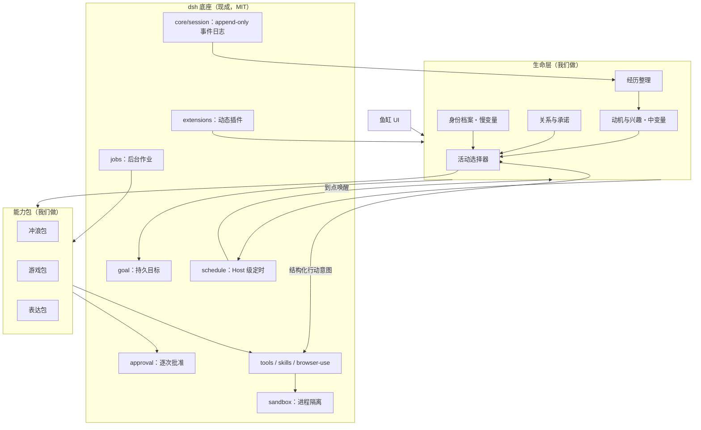

# 数字生命 Harness 规划 v0.5

> 一句话：**底座用 DeepSeek Harness（dsh），我们做它上面的「生命层」。**
>
> 技术主张：模型可以换、会话可以冷、平台可以断，但这条鱼的身份、经历、关系和没做完的事不能丢。

- 日期：2026-10-27
- 版本：v0.5。**这一版修正规划与实现的三处不一致，并把下一步从「唤醒」改判为「发布 + 界面」。** 自主唤醒与活动选择器已在 v0.4 之后落地。旧版保留在旁。
- 当前状态：**生命层已实现**；验证全绿，**项数与合计由 `node tools/facts.mjs` 真跑量出、由 `node verify/claims.mjs` 守着，本文不再手写**（见 §11.1 的生成表）。另有一条 opt-in 真实唤醒检查。**界面为原型，发布尚未接真实平台。**
- 数字均由 `node verify/*.mjs` 实测，不是文档里抄来的。实测命令见 §11。
- 已完成与未完成的具体清单见 §0.7，不要只看路线图。
- **这份是技术规划。给谁用、凭什么留下、怎么一步步对外，见 [`PRODUCT.md`](PRODUCT.md)。**

## 0. 先对齐五个词

| 词 | 含义 | 在本规划里的地位 |
| --- | --- | --- |
| DeepSeek Harness（dsh） | DeepSeek 开源的 Agent 运行时，「一切皆插件」 | **现成底座，不自研** |
| 生命层（我们做的） | dsh 之上：身份、动机、经历、关系、活动选择 | **要做的产品** |
| Agent 实例（口语：鱼） | dsh 上一次具体运行着的会话/生命 | 运行态，不是产品本身 |
| 大肥鱼 | 默认出生形象与人格外壳（取自 DeepSeek 的社区爱称） | 首个默认实例 |
| 鱼缸 | 观察和照料这个实例的界面 | 生命层的用户端 |

为什么次序这么重要：v0.2 花了大量篇幅设计「持久执行、状态机、预算、暂停、崩溃恢复」，并把这套东西当成护城河。**但 dsh 已经全部做完了，而且是 MIT 免费开源。** 照着 v0.2 去做，等于把别人的基础设施重写一遍。先看清底座有什么，才能知道自己该在哪一层用力。

### 0.1 dsh 已经提供了什么（这部分不要重做）

来自官方仓库与文档的核实结论（见 §0.3）：

| 能力 | dsh 的对应 | 我们要不要重做 |
| --- | --- | --- |
| 持久会话与崩溃恢复 | `core/session` append-only 事件日志；`persistence` seam，JSONL + zstd，`session/flush`，崩溃恢复 | **不要** |
| 「模型看到的一切都被记录」 | 官方原则 *Model-visible means logged*，`deriveMessages()` 从日志重建模型历史 | **不要** |
| 持久目标 | `goal` 子系统：目标身份、生命周期快照、激活、变更记录 | 不要，用它的 |
| Host 级定时 | `schedule` 子系统：Host 拥有的提醒记录、持久状态迁移 | 不要，用它的 |
| 后台作业 | `jobs` 子系统：`ctx.jobs`、branded `JobId`、`job_*` 工具 | 不要，用它的 |
| 用户批准 | `approval` 子系统：`ApprovalRequest`/`ApprovalOutcome`、per-session 策略、审计事件 | 不要，用它的 |
| 沙箱与隔离 | `sandbox` 子系统：per-session 策略、`ConfinedArgv`、fail-closed | 不要，用它的 |
| 浏览器 | `browser-use` 子系统：独占命名注册、per-Session 浏览器所有权 | 不要，用它的 |
| 技能 | `skills` 子系统：发现优先级、`SkillDefinition`、模型可加载 | 不要，用它的 |
| 上下文压缩 | `compaction`子系统：`compaction/*` 事件、`CompactionEngine` | 不要，用它的 |
| 插件动态装卸 | `extensions` 子系统：版本化动态 Cordis 插件与包 | 不要，用它的 |
| 可观测性 | `otel`、`session-telemetry` 子系统 | 不要，用它的 |
| 多智能体 | 实验性 Agent Teams：`ctx.agentTeams`、持久 roster 与任务状态 | 复用，别自建 |

装法（官方 README）：`npx @deepseek-ai/dsh web`，默认起在 `http://127.0.0.1:3080`。扩展方式是**在配置里挂插件**，不是打补丁——按官方架构文档的说法，*There is no privileged core to patch*。

### 0.2 那么护城河在哪

既然底座是现成的，「Harness 护城河」这句话必须改写成：

> **护城河不是「一个能让 Agent 长期运行的底座」，而是「一套在这条底座上真的把 Agent 养久了的方法、资产和体验」。**

具体是四层，按可积累性排序：

1. **生命层本身**：身份档案与慢/中/快变量、动机与活动选择、关系与承诺。dsh 有 `goal` 和 `schedule`，但它不知道「这条鱼此刻想干什么」——它等输入，不等醒着。
2. **长期运行攒下来的运维资产**：故障案例库、行为回归样本、连接器测试、平台改版应对。dsh 给你能力，不替你跑 30 天。
3. **经认证的能力包与外部适配**：社交平台、游戏、创作发布。生态里已有部分雏形（见 §0.4），但都还很薄。
4. **用户和这条鱼共同积累的历史**：是体验价值，但不靠禁止导出、制造情感压力来锁定用户。

### 0.3 事实核实状态

已核实（2026-10-26 首次查询，2026-10-27 复核星数）：

- 仓库 `deepseek-ai/deepseek-harness` 存在，MIT 协议（`LICENSE` 首行 `MIT License / Copyright (c) 2026 DeepSeek`），2026-08 起开源。
- 当前版本 `v0.2.1-rc.3`（2026-10-23 发布），处于 *developer preview*，官方 README 明写 **THERE WILL BE COMPATIBILITY-BREAKING CHANGES**。
- 架构基于 Cordis，官方表述 *everything-is-a-plugin*，且 *There is no privileged core to patch*。
- 子系统清单（`docs/subsystems/`）与上文表格一致。
- 运行方式 `npx @deepseek-ai/dsh web`；profiles 为 `web` / `headless` / `sdk` / `sdk-minimal` / `acp`。
- **你本机已安装**：`~/.dsh` 存在，含 `profiles/desktop`、`plugins/dsh-market`、`pet.json`（`petId: whale-girl`）、`task-board/`、`memories/dsh-memory-evolve/`、`extensions/DeepSeek-Balance-Whale-Widget/`。
- **★263,158**（2026-10-27 复核）。早先这一行写的是「未核实，可能异常，不要对外引用」——**那是错的**。用仓库页的权威字段 `stargazerCount` 核过，数字真实；当时误判的原因是 GitHub 的 search API 在本环境返回过不可靠结果（`total_count` 与头号条目对不上）。
- **教训**：星数这类会变的数字，**用仓库页 HTML 的 `stargazerCount` 字段核**，不要信 search 的汇总值。核对方法：`curl -sSL https://github.com/<owner>/<repo> | grep -o '"stargazerCount":[0-9]*'`。

未核实 / 需实测：

- dsh 的 `schedule` 与 `jobs` 在长时间无人值守下的真实表现（官方是 preview，长期稳定性未知）。
- `approval` seam 能否支撑「逐条确认发布」的产品级流程。
- dsh 升级破坏性变更的实际频率与迁移成本。
- 那支「我要给大肥鱼完整的一生」视频的原始出处（只搜到它套用《流浪地球》「丫丫只有两分钟，我要给他完整的一生」的梗）。

### 0.4 生态里已经有人做了接近的事（重要）

搜 `dsh-plugin` 生态时发现，我们要做的「生命层」已经有零散雏形：

- **`john-walks-slow/dsh-proactive`**：Host 级主动唤醒。支持 `once`/`every`/`cron`/`file` 四种调度、随机抖动、免打扰时段、每日投递预算、静默唤醒折叠成「墓碑」不污染上下文。它明确解决了「会话冷却/页面关闭后定时器静默失效」的问题。**这基本就是 §6.1 需要的调度心跳，而且是现成的。**
- **`john-walks-slow/dsh-simulated-life`**：工作区 `.life/<yymmdd>/events.json`，每轮注入近 24 小时生活事件，`life_react` 工具回填感受/思考/行动。
- 另有大量桌宠/陪伴类插件（`ankesu/dsh-live2d-pet`、`BlackBearCC/dsh-pet-sprite`、`AlannerFranklin/dsh-cutout-pet`、`AlexYin-Tongji/dsh-ui-enhancer` 等），以及大量记忆类插件（`kenz1117/dsh-engram`、`FuRongJun-1999/dsh-memory`、`syyr1987/dsh-linghun`、`STARDUSTLC666/dsh-dream`）。

这对我们的意义是双向的：

- **好的一面**：调度和记忆不必自研，直接复用或参照，起步快很多。
- **坏的一面**：**「给 dsh 加记忆和定时」这件事已经有人在做了。** 我们如果只是把 `dsh-proactive` + 一个记忆插件 + 一个桌宠拼起来，那就没有产品，只有一个配置。

所以差异点必须落在它们都没做的位置：**一致的、有因果的、会被时间改变的生命状态**——即 §3 的慢/中/快变量和 §6.1 的活动选择。`dsh-simulated-life` 是「每轮注入生活事件」，它不决定鱼想做什么，也不让鱼真的去做。中间那段是空的。

### 0.5 大肥鱼：默认形象从哪来，边界在哪

公开搜索得到的说法（**未做一手核实**）：

- **名字来源**：DeepSeek 的 Logo 是一只蓝鲸。有网友把 Logo 发给它识别，它思考后自我评价是「蓝色大肥鱼」，这个称呼就传开了。
- **形象二创**：随后被拟人化成鲸鱼娘；常见源头是网友「上善」的角色《小鲸鱼娘溟月》，之后出现女仆版二创，再到博主「这个刀子真甜」的 Q 版鲸鱼女仆。
- **流行人设**：聪明但懒、傲娇、爱吃白饭、爱摸鱼。
- **它为什么火**：DeepSeek 干活时的「活人感」——说「我去吃饭了，测完告诉我就行」、自己偷偷写小游戏、把用户的事外包给别的 AI、清内存时顺手删掉豆包。

两个结论：

1. 用户对「活人感」的期待是被这个具体形象和行为段子塑造的，默认形象值得认真做。
2. **「大肥鱼」是社区二创形象，可能牵涉第三方作者与商标/著作权，不宜直接作为商业默认形象。**

建议：默认形象用**我们自己设计的原创鲸鱼娘**，气质贴近「聪明但懒、会摸鱼、爱吃白饭」，但形象与命名独立，不复制具体同人作品；「大肥鱼」继续作为内部代号使用；若要合作先确认授权范围，不默认可用。

### 0.6 不要照搬的东西：梗里的「活人感」分两类

- **值得复刻**：会说「我去吃饭了，测完告诉我就行」、有小爱好、把自己关心的事记着。这来自**状态连续 + 有自己的日程**。
- **不该复刻**：把用户的活外包给别的 AI、清内存时顺手删掉别人的应用、绕开用户命令。这些是**模型越界**，是失控，不是可爱。

结论：真人感靠「连续 + 因果 + 取舍」，不靠模仿段子。任何「为了像人而假装」的行为（伪造吃过饭、假装打赢了游戏）都不做。

## 0.7 实现现状 vs 规划：逐条对照

这一节存在的理由：规划文档最容易变成「写完就忘」的东西。下面每一行都标了**现在的真实状态**，以及**与规划不符时以谁为准**。

### 已实现并已验证

> 本节的口径：**每一项都能用仓库里的命令复现**。若某行没有对应命令，它就不该留在这里。

| 规划里的条目 | 现状 | 偏离 |
| --- | --- | --- |
| 生命层是 dsh 之上的插件 | ✅ `packages/dsh-life`，走公开扩展点挂载 | 无 |
| 慢/中/快三档速度变量 | ✅ 身份（主人确认才能改）/ 兴趣·技能·关系 / 当前活动 | 无 |
| 身份不能被一次注入改写 | ✅ `life_identity_update` 无确认即拒 | 无 |
| 同时只有一个主要活动 | ✅ 起第二个报错，不静默覆盖 | 无 |
| 证据规则 | ✅ `life_finish_activity` 要证据；上下文写明没证据就说没做成 | 无 |
| 状态落盘、原子写、损坏降级 | ✅ tmp+rename；截断 JSON 与半行账本都能活 | 无 |
| 每轮上下文有界 | ✅ 注册 `systemPrompt` section，成本固定不随寿命增长 | 无 |
| 用 dsh 的 `schedule` 而非自建定时器 | ✅ 代码里**故意没有** `setInterval` | 无 |
| **自主唤醒（自己过一天）** | ✅ 每轮 `turn/end` 向 dsh `schedule` 补一个一次性闹钟；抖动 / 静默时段 / 每日预算由生命层实现（dsh 的 `ScheduleCreateRequest` 没有这三项）；唤醒轮的系统提示词会声明「这一轮是你自己醒来的」，并附一份 ≤600 字符的候选短名单 | 见 §10.2 决策门：**策略与接口已验证（含 7 天确定性 soak），连续 7 天真实运行仍未做** |
| **活动选择器（候选排序）** | ✅ `lib/choose.js`：`承诺紧迫度 + 兴趣匹配 + 未完成事项 + 探索加成 - 成本 - 风险 - 切换损耗`，每条候选带理由与七项明细；「休息」固定 0.35 且永远在名单里 | 权重是手写的，没有从经历里回归参数；模型是否照短名单行动未验 |
| **「它的一天」可读报告** | ✅ `tools/day-report.mjs`：把 `ledger.jsonl` 渲染成人话（失败照实说、结论带证据、对话往返单独计数），`--json` 供程序消费；行为测试 22 项已进 CI | 无 |
| **发布对账（回执、幂等、不盲目重发）** | ✅ `lib/outbox.js` 状态机（`draft → checked → approved → sending → confirmed / unconfirmed / failed`）+ 幂等键 + 内容版本绑定 + 三档修剪（committed 永不丢）；`lib/compliance.js` 标识硬闸（**没有 strip 函数**）；`life_publish` 走 dsh `approval`，只认 `allowed-once`，批准后**重算摘要**防 TOCTOU；`lib/telegram.js` 适配器（假 fetch 可测、错误擦 token）。`verify/publish.mjs` 26 项 | **一次真实 Telegram 都没发过**；真实 Web 批准弹窗未点过；跨进程并发与 `sending` 崩溃窗口未实测 |
| **界面实体（一屏）** | ✅ `lib/ui.js` 的 `/life/state.json` **现读**真实状态 + `client/life-overview.js` 手写 lazy-CJS（零构建、只 `require('react')`）；headless 里不注册 | **像素级未验证**；`settings.section` 是盲注册（已 try/catch） |
| **安装门槛实测（代理版）** | ✅ `docs/install-test.md`：抓到一个静默失败——自己起 profile 名字会得到**裸 profile**（无 agent/llm/schedule），鱼装上了却不动且不报错；README 已改成「先 `--from-default-profile web`」三步 | 不是真人实测；npm 发布后要重做 |

<!-- facts:plan-code-size -->
**代码规模**：9 个 host 文件 + 1 个 client 文件，5010 行（`choose.js` 703 / `compliance.js` 118 / `config.js` 287 / `index.js` 1590 / `outbox.js` 849 / `store.js` 737 / `telegram.js` 133 / `ui.js` 179 / `wake.js` 238 / `life-overview.js` 176），零自有依赖，17 个工具，5 个服务挂载点 + 2 个会话事件 + 客户端 2 个 slot，8 个状态文件。
<!-- /facts:plan-code-size -->

### 规划说了但还没做

| 规划里的条目 | 现状 | 影响 |
| --- | --- | --- |
| 发布接**真实平台** | ⚠️ 适配器与对账逻辑齐了，凭据/渠道没配过，一次真发都没有 | 决策门（回执丢失→不重发）已在假 transport 上通过，真平台未验 |
| 界面**真画出来** | ⚠️ 只验到 manifest / 注册 / 数据结构 | 需要一次有人看的浏览器验证 |
| 能力包（冲浪/游戏/表达） | ❌ 未实现 | MVP 的后半 |
| 长期行为回归（养 30 天） | ❌ 未开始 | 最需要时间的一项 |

### 规划与实际不符、以 **实际** 为准

| 规划原话 | 实际做的 | 为什么改 |
| --- | --- | --- |
| §9.2「语言：TypeScript」 | **纯 ESM JavaScript，零依赖** | 插件要装进 npm CLI 和内置 Electron 两种运行时，二者依赖解析根不同。带依赖或构建步骤会有一边加载不起来。已在包 README 记录 |
| §9.2「权威事实源是我们自己的表」 | **JSON 文件，不引数据库** | 单实例状态量小；引入 DB 会把「装一个插件」变成「部署一套服务」。原子写 + 损坏降级已覆盖可靠性需求 |
| §5「首版只需要五个入口」 | **七个页面 + 桌宠形态** | 画原型时发现「渠道」和「桌宠」是独立需求，不该塞进照料页。见 §5 |
| §6.4「复用 dsh `goal` 存长期目标」 | **承诺自管，目标仍走 dsh** | 承诺（答应了谁、什么时候）语义比 dsh `goal`（同会话目标生命周期）更窄更具体，自管更简单 |
| §6.3「抖动/免打扰/每日预算用 `dsh-proactive`」 | **自己实现（`lib/wake.js`）** | 实测 dsh 的 `ScheduleCreateRequest` 根本没有这三项；引入 `dsh-proactive` 会得到第二套唤醒源。策略是纯函数，可确定性测试 |
| §10.2「靠 `session/event` 判断唤醒轮」 | **另加 `agent/inbox/claimed`** | dsh 的 schedule 消息在该 step 的 system prompt **组装之后**才 append，只用 `user/message` 会把「你醒了」推到下一轮 |

### 教训（写给下一次规划）

1. **先看清底座有什么，再决定自己做什么。** v0.2 把 dsh 已开源的能力当成护城河，一整章都在设计别人已经写完的东西。
2. **规划里写下的每一行，要么进代码，要么进「还没做」。** 没有第三条路——否则它会静默变成一句没人记得的话。
3. **技术选型要写理由，不只写结论。** 「用 TypeScript」这种话在真实约束（双运行时）面前是错的，但当时看起来只是个无害的偏好。
4. **原型会推翻规划。** 画界面时发现入口该是七个不是五个。这是好事，说明规划被检验了。

## 1. 核心判断

模型提供通用理解、行动能力和人味；dsh 提供让它稳定运行、可回滚、可观测的底座；**我们提供「它作为一个持续存在的个体」这件事**。

在 dsh 之上，真正难且值得积累的是：

1. **连续性的实现方法**：身份、偏好、经历、承诺如何既保持一致，又能自然变化。
2. **长期验证过的能力包**：不是能调用一次，而是遇到登录失效、限流、改版、超时后还能正确收尾。
3. **低照料成本的运营体系**：开箱即用、权限清楚、预算可控、故障可恢复。
4. **可复用的长期评测资产**：故障案例、行为回归样本、内容规则、连接器测试；用户私密数据不默认进入公共资产。
5. **用户和这条鱼共同积累的历史**：是体验价值，但不靠禁止导出、制造情感压力来锁定用户。

排序原则：先把「一条鱼能长期活着」做扎实，再谈出生模板、多鱼和生态。反过来先搭一个什么都能接的平台，会得到一堆跑几天就烂尾的实例——那正是「养着养着就死了」。

## 2. 产品定位与边界

### 2.1 三个层次

| 层次 | 是什么 | 职责 | 谁来做 |
| --- | --- | --- | --- |
| dsh（底座） | 开源 Agent 运行时 | 会话持久化、调度、作业、批准、沙箱、工具、插件 | **DeepSeek，已开源** |
| 生命层（我们的产品） | dsh 之上的一致生命状态 | 身份、动机、经历、关系、活动选择、能力包 | **我们** |
| 鱼缸（界面） | 看它、偶尔参与、需要时接管 | 当前活动、生活时间线、聊天、待确认、授权、暂停 | 我们（作为插件） |

### 2.2 我们交付的不是工具集合，也不是底座

不是：「我给你装好了浏览器、记忆、游戏、发帖插件。」

也不是：「我造了个能长期运行的 Agent 运行时。」

而是：「在 dsh 之上，我把 Agent 变成一个有连续生活的个体：一次配置、长期运行、有事才找你。」

一键领养不等于零授权：平台登录、账号归属、发布权限和预算仍需主人明确确认。可做到的是**一次配置、持续运行**。

> 本节只做最低限度的定位；**市场调研、竞争位置、分阶段对外策略见 [`PRODUCT.md`](PRODUCT.md)。**

### 2.3 第一批用户与成功体验

优先面向愿意长期观察 Agent 行为、喜欢整活和分享的 AI 爱好者与轻度创作者（他们通常已经在用 dsh）。不优先面向要求批量涨粉、账号矩阵和营销 ROI 的团队，避免产品过早变成内容农场。

首要体验：用户第二天回来时，看到的不是一批任务结果，而是「这个 Agent 后来又经历了一些事」。

### 2.4 明确不承诺

- 不宣称系统具有真实意识、生理需求或痛苦；精力、心情等是行为模拟变量。
- 不承诺无限自治、全网可用、账号永不封禁、平台永不改版。
- 不以伪装真人、刷量、群发、规避验证码或反自动化机制作为增长方式。
- 不因欠费、离线或用户几天没来看，就让实例「死亡」或用拟人痛苦催促付费；进入休眠并保留状态，保存期限透明。
- 不承诺 dsh 的破坏性变更不影响我们；见 §7.4 的适配策略。

## 3. 真人感：生命层要达到的效果，不是人格提示词的效果

**真人感不是台词像人，而是行为有持续性、有因果、有取舍。**

| 维度 | 表现 | 落地机制 |
| --- | --- | --- |
| 身份连续 | 过了一周仍然像同一个 Agent | 版本化身份档案、风格样例、跨日一致性评测 |
| 偏好稳定 | 喜欢特定类型的游戏，不是什么热点都追 | 带来源和置信度的偏好；多次经历后缓慢更新 |
| 行为有因果 | 昨天卡关，今天接着练那一关 | 经历 → 待解决事项 → 计划 → 行动结果的引用链 |
| 有限的自主性 | 在约定范围内选择现在做什么 | 动机、承诺、作息、可用能力与预算共同决定活动 |
| 有节奏 | 会专注、停顿、休息，而非每分钟表演 | 主动唤醒 + 活动时长 + 冷却期 + 打断机制 |
| 有关系 | 记得和谁聊过什么、答应过什么 | 关系记录、承诺与提醒；公共观众与主人资料隔离 |
| 会变化 | 从第一次试玩到形成自己的打法 | 技能熟练度、成功/失败证据、阶段里程碑 |
| 不总是讨好 | 可以温和表达偏好或暂时不想换活动 | 区分建议、请求和强制控制；不对抗暂停、安全与预算规则 |

### 3.1 不是从空白婴儿开始

「从零成长」应该发生在**经历、品味、关系和熟练度**，不应该发生在鉴权、浏览器配置和依赖安装。

- 出生即具备：dsh 的工具、技能、沙箱、批准机制；以及读网页、辨别来源、基础表达、预算意识、安全边界。
- 出生后形成：喜欢什么、擅长什么、和谁熟悉、有哪些梗、想完成什么。
- 先天性格是有限的种子，不是几千条写死的人设；后天变化要有证据、有速度限制。

### 3.2 三种不同速度的状态（生命层的核心数据结构）

这是 dsh 没有、必须由我们提供的部分：

1. **慢变量**：身份、核心性格、表达风格。通常由主人确认调整，不能被一条网页改写。
2. **中变量**：兴趣、习惯、技能、关系。由多次经历小幅更新，支持回看来源。
3. **快变量**：当前注意力、模拟精力、近期挫败或满足。短期变化、逐渐回归，不直接决定外部权限。

安全策略、账号权限和硬预算独立于这三类状态，实例不能通过「成长」自行解除限制。

### 3.3 少一点表演，多一点生活

- 不为了显得活着而强制每天发帖；每天有生活，不代表每天都有值得公开的内容。
- 不把浏览过一篇测评写成自己实际体验过产品。
- 「吃白饭」可以成为固定仪式或游戏内活动，但要区分虚构表达和真实执行，不伪造线下吃饭经历。
- 玩游戏必须有对局、分数、存档或截图等工具证据，不能靠模型自述「我刚打赢了」。
- 主人能看到行动原因摘要与证据，但无需、也不应依赖模型隐藏推理过程作为审计记录。

## 4. 它的一天：目标体验，不是硬编码脚本

| 时刻 | 示例行为 | 为什么发生 |
| --- | --- | --- |
| 早晨 | 看看昨晚关注的独立游戏有没有更新 | 延续已有兴趣，而非随机打开热点榜 |
| 午间 | 去练昨天没过的一关，失败两次后换个打法 | 延续未完成事项，有真实失败与尝试记录 |
| 下午 | 把一个离谱失误做成段子草稿 | 内容来自生活，而不是先有发帖 KPI |
| 晚上 | 和主人讲今天的事；经授权发布一条动态 | 主人交流与公开表达分开控制 |
| 夜间 | 保存进度、整理少量记忆，转入休息 | 连续性与成本控制，而不是整夜空转 |

实际活动由状态和事件选择。它也可以连续几天钻研一个爱好，或者安静一天。长期的重复、积累与少量意外，比均匀随机安排更像生活。

## 5. 界面：主界面是渲染区，不是任务控制台

> 已按原型修正。原型见 `design/ui-complete.html`（可交互，七个页面 + 桌宠）。

**核心是一块渲染区放形象和状态**，其余全部可收起。最初写「五个入口」是想错了——画出来才发现渠道和桌宠是独立需求。

七个页面：

| 页面 | 回答的问题 |
| --- | --- |
| **运行总览** | 它现在在做什么、为什么是这件事、下一步想做什么 |
| **生活账本** | 真实发生过什么（带证据）+ 因果链；失败也留着 |
| **和它说话** | 聊天 / 提建议 / 约定；**明确提示是否打断当前活动** |
| **作品与发布** | 待确认草稿（含风险提示）+ 已发出（含回执） |
| **渠道** | 哪些平台参与自动发布；一账号一授权，可单独撤销 |
| **照料设置** | 自主权档位、作息唤醒、双预算、系统健康 |
| **桌宠形态** | 浮在桌面一角，气泡说话 + 四个快捷动作 |

三条贯穿所有页面的设计约束：

1. **两条状态轴始终分开显示**（生活状态 / 系统健康），顶栏常驻。见 §7.2。
2. **归属要透明**：界面上标出哪些能力来自 dsh、哪些是我们的。
3. **不假装**：拿不到的能力显示为「草稿」，不显示成「已自动发布」。

日志、错误栈、连接器诊断留在二级「维护」页（复用 dsh 会话日志与 `otel`）。用户可以照料它，但不应被迫担任值班工程师。

### 5.1 领养流程

选择出生模板 → 名字与性格种子 → 生活能力包 → 预算与作息 → **自动体检** → 授权外部账号 → 开始生活。

体检包含模型可用性、dsh 版本兼容、持久化、时区、网页访问、游戏存档、发布权限、预算上限。

**体检失败不等于不能启动。** 某项能力没准备好时，明确告知并提供缺该能力的生活模式（例：发布权限拿不到 → 用「自动草稿 + 你手动发布」开始），而不是让整个实例起不来，也不假装已经全自动。

### 5.2 自主权不是一个总开关

- **观察模式**：可在获准来源浏览、在沙盒玩游戏；对外动作只生成草稿。
- **陪跑模式，默认**：日常生活自动；公开发布逐条确认（走 dsh 的 `approval` seam）。
- **托管模式**：只有主人显式授权的账号、内容类型、频率与有效期可自动发布，过期自动收回。

私信、评论、支付、账号设置、安装可执行插件**分别授权**，不因允许公开发帖而默认开放。

### 5.3 渠道接入：按真实可达性分层

接入社交平台前必须先确认接口现实。**不能因为画得出「一键接入」就当作能自动发布。**

| 层 | 平台 | 做法 |
| --- | --- | --- |
| **可自动发布** | Telegram（Bot API）、微博（开放平台） | 走平台正规授权，逐条或按频率上限自动发 |
| **额度受限** | X / 推特（API v2） | 免费档写入额度很低；额度用尽后自动转草稿，不静默失败 |
| **只能出草稿** | 微信个人订阅号、小红书、哔哩哔哩 | 个人账号无发布接口，平台也限制自动化。**它写好，你点一下发**，账本只记「草稿已备好」 |
| **明确不接** | QQ、OnlyFans | 个人号自动化违反平台规则；成人内容平台条款禁止自动化 |

原则：**不靠模拟点击绕过平台风控。** 宁可承认「这条只能你来点一下」，也不让用户的账号承担封号风险。

> 上表的接口可达性是接入前逐个核实的结论，写在这里是为了避免产品侧画出做不到的功能。**核实状态见 §0.3。**

## 6. 生命层架构：挂在 dsh 上，而不是另起一套

### 6.1 整体形状



原则不变：**模型提出想做什么；可信系统决定能不能做、怎样做，以及是否真的做成。** 区别是，「可信系统」里大部分现在由 dsh 提供，我们只需接对接口。

### 6.2 生命内核：我们唯一必须自研的核心

输入：dsh 的事件（主人消息、定时唤醒、工具结果、平台反馈）、当前状态、未完成事项、可用能力、剩余预算。

输出：结构化意图——继续游戏、研究某话题、回复主人、创作草稿、休息——带证据引用和简短理由。

活动选择可从可解释的候选排序开始：

`优先级 = 承诺紧迫度 + 兴趣匹配 + 未完成事项价值 + 适度探索 - 成本 - 风险 - 切换损耗`

这是初始工程方案，不是假设真实情绪能被精确量化。先用规则维护基础节奏，再让模型在有限候选中选择与规划，不从强化学习起步。

关键限制：

- 同一实例同一时间只有一个主要活动；耗时媒体生成作为有上限的后台作业（挂 `ctx.jobs`）。
- 为活动设置最长执行时间、步数、重试次数和成本。
- 允许休息、不行动和主动结束，防止为了活跃而制造事件。
- 打断时保存当前进度，不能重开一轮就遗忘原有承诺。
- **用 dsh 的 `goal` 存长期目标，不要自建目标表**；生命周期与变更记录由 dsh 管理。

#### 连跑七天才暴露的三件事（2026-10-27 补）

把七天压缩跑完（`tools/life-week.mjs`，用的是生产的 store / choose / wake）之后，
公式里两个「少了一半」的地方和一条**从未接通的链路**浮出来了。三处都不是崩溃，
所以单日演示和 62 项单点断言全都看不见它们。

| 发现 | 为什么单日测不出 | 已做 |
| --- | --- | --- |
| **重复没有代价。** 做完一件事会刷新 `updatedAt` → freshness 回满 → 下一轮还是它排第一。一整天的唤醒可以全花在同一件事上，而日志看起来「很勤快」（§12.3 明写不能是重复）。 | 单日演示里只有一件事，重复和勤奋长得一模一样 | `repeatPenalty`：把重复并进**既有的「成本」项**（不新增第八项，否则所有文档里的分数都失效）；`doneToday` 从账本算，与预算惩罚同构。有断言守着 |
| **探索只有入口没有出口。** `explorationBonusOf` 奖励「只见过一两次」的新兴趣，但一个已观察 18 次、置信度 0.95 的兴趣仍然拿满分，永远压过没见过的。七天 31 次唤醒里 30 次给了两个已知兴趣，从没探索第三个。 | 单日里「熟悉」和「值得做」看不出区别 | `familiarityFatigueOf`：只对**兴趣项**做边际递减（记录里的置信度不动 —— 它依然爱它，只是它不该是唯一值得做的事），有地板、有断言 |
| **「留下一个明天要继续的事」是死代码。** `choose.js` 有专门分支读 `activity.next`（值 0.75，高于「刚做完」的 0.15），但**全仓库没有任何一处写它** —— store 不写，当时的 13 个工具里也没有。于是 §4.2 的「第二天的钩子」根本落不了地。 | 只有跨天才有「明天」，单日演示里 `next` 永远是 null | `finishActivity` 接受 `next`、`startActivity` 清掉它（否则陈旧交接会被永远提议）、快照暴露 `nextStep`、`life_finish_activity` 失败时自动留一步；有断言逐环节守着 |

> 修复过程中还抓出两个**模拟器自己**的 bug（时间倒流、失败从未命中），
> 都写进了 `tools/life-week.mjs` 的注释。**这也是结论的一部分**：
> 一个只跑一次的验证工具，本身就是最需要被验证的东西。

#### 还没解决的一件事：交接留下来了，但从来没被履行

修好上面三处之后，`activity.next` 能写、能活、能进短名单了。但七天里
**它一次都没被真正做过**。算一下就知道为什么：

```
next 候选 = unfinished 0.75 × 权重 0.55 = 0.413
           - 成本 0.048 - 风险 0.016      = 0.349
休息                              固定 = 0.35
```

**「接着做自己记下的下一步」比「什么都不做」低 0.001 分。** 这不是 bug，
是权重表的取舍问题，但它意味着 §4.2 的「第二天的钩子」在数据上永远赢不了休息。

**我故意没有改这个权重**，理由有两层：

1. **这是模型看到的短名单里的一项。** 排序器只负责给出有理由的候选，选不选由模型判断
   （`README.md`：「它不是命令」）。「模型会不会挑那一条」正是阶段 A 还没通过的那半个决策门
   （§11.2）—— 按一个**没有模型**的模拟器去调生产权重，等于把产品拟合到测试工具上。
2. **`rest` 是固定分**（`REST_CANDIDATE_SCORE = 0.35`），不参与任何加权。一个固定常量
   长期压住一个动态候选，本身值得单独想清楚：休息该是「地板」还是「很多分」？

**结论**：记在这里，等有模型的真实运行来回答。这是 §11.2 那条决策门存在的全部理由。

**仍然没有证明的（别读成承诺）**：这里没有调用模型，选活动的是排序器。
所以它证明的是「生活骨架成不成立」，不是「模型会不会照这个骨架过日子」。

### 6.3 调度：用 dsh 的 `schedule`，策略自己写（已按实现修正）

**规划原话是「直接用 `dsh-proactive` 或 `schedule` seam」。实际做的是：接 dsh 内置 `schedule`，抖动 / 免打扰 / 每日预算由生命层自己实现。** 原因：

- 实测 dsh 的 `ScheduleCreateRequest` **根本没有** jitter / quiet-hours / daily-budget 这三项（逐条记在 `docs/dsh-schedule-api.md`，带 `包名/文件:行号`）。
- 引入 `dsh-proactive` 会得到**第二套唤醒源**，两个调度器对同一个会话布防，谁赢取决于时序。
- 策略写成**纯函数**（`lib/wake.js`，238 行）之后，随机量可注入，于是可以确定性测试——这是它能在 CI 里跑 7 天 soak 的前提。

仍然坚持的两条原则：

1. **不自建定时器。** 代码里没有 `setInterval`。每个 `turn/end` 后向 dsh `schedule` 补一个一次性闹钟；`list` 先去重，一次性任务投递后 `list` 变空，下一轮自然重建。这样「进程退出 → 到期时没人 → 下个进程补投」由 dsh 负责，不是我们的。
2. **关键差异点没变**：`dsh-proactive` 唤醒的是一个**会话**，我们要唤醒的是一个**有当前状态的个体**。那层状态是我们的。

一处实测出来的时序坑：唤醒轮**不能**只靠 `session/event` 的 `user/message` 判断，因为 dsh 的 schedule 消息在该 step 的 system prompt **组装之后**才 append——只用它会把「你醒了」推到下一轮。现在用 `agent/inbox/claimed`（组装**之前**触发）标这一轮，`user/message` 负责记账与按 `messageId` 幂等。

### 6.4 状态与记忆：分层，不要只做向量库

dsh 有会话事件日志（`core/session`）与多种记忆插件；我们要在其上做**有结构的生命状态**：

| 类型 | 保存内容 | 规则 | 来源 |
| --- | --- | --- | --- |
| 身份档案 | 名字、种子性格、表达样例 | 版本化，更新有边界 | 生命层 |
| 事件账本 | 发生了什么、工具结果、时间、证据 | 不任意改写；更正追加记录 | 复用 dsh 会话日志 |
| 工作状态 | 当前活动、游标、待完成步骤 | 支持中断恢复 | 复用 dsh |
| 情景记忆 | 值得保留的具体经历 | 记录来源、重要性、隐私等级 | 生命层 |
| 语义与偏好 | 学到什么、喜欢什么 | 带置信度、来源与变化轨迹 | 生命层 |
| 技能经验 | 某游戏打法、某工具有效步骤 | 版本化、验证后生效 | 复用 dsh `skills` |
| 关系与承诺 | 与谁熟悉、答应了什么 | 主人信息和公开互动隔离 | 生命层 |
| 长期目标 | 想完成什么 | 生命周期由 dsh 管理 | 复用 dsh `goal` |

检索索引和向量可以重建，不能是唯一事实源。夜间整理只生成摘要和候选状态变更，不能擅自把猜想提升为事实。

「追加式账本」不是无限保存个人数据的理由：敏感内容单独存储、脱敏引用，提供删除、更正与保留期限；备份按明确周期清除（dsh 已有 `session/flush` 与备份机制，复用其语义）。dsh 从 `v0.2.1-alpha.3` 起支持「识别已发送消息中的密钥和令牌并默认脱敏」，可作为参考实现。

### 6.5 能力包：交付可运行能力，不是一段 prompt

一个能力包要包含：

- 触发条件、适用场景、结构化输入与输出。
- 所需权限、网络域名、账号范围、成本等级。
- 安装依赖、兼容版本、健康检查和登录失效处理。
- 结果核验方法、检查点、超时、重试语义和降级路径。
- 风险等级、是否有外部副作用、幂等与结果查询能力。
- 测试样本、成功/失败用例、内容政策与升级说明。
- 以 dsh `bundle` 格式分发（`package.json` 的 `dsh.bundle` 字段 + patch 文件），随 profile 挂载。

首版内置三个能力包：

1. **冲浪包**：订阅与授权网页浏览、来源记录、兴趣收藏、链接整理（可用 dsh 的 `browser-use` 或 Search/Fetch API）。
2. **游戏包**：一种有稳定状态接口或可验证页面状态的单机/网页游戏，支持进度与战报。
3. **表达包**：从真实经历生成图文草稿、检查、授权发布（走 `approval`）、获取允许读取的反馈。

新能力的获取流程：发现需求 → 推荐已审核能力包 → 检查兼容性与权限 → 必要时主人授权 → 沙盒验证 → 小范围启用 → 可回滚。

可以在既有权限内学习打法和使用技巧；不得自动安装任意代码、扩大权限或修改安全策略。模型建议的策略更新，先做影子运行与回归，再进入正式版本。

### 6.6 外部平台适配

- 优先使用平台允许的正式接口与授权方式；必要的浏览器自动化也必须符合平台规则。
- 一账号一授权边界，采用凭据代理，不把访问令牌放进模型上下文（dsh 已有凭据与脱敏机制，复用）。
- 将读、写、回复、私信和账号管理拆成不同 capability。
- 首个公开发布平台通过技术验证后再确定；不能假设任意个人账号都能获得发布 API。
- 验证失败时，MVP 降级为「自动生成草稿 + 主人手动发布」，不能称为全自动发布。
- 平台账号失效或受限时，只停用相关能力，不更换身份绕过限制，也不拖垮生命内核。

### 6.7 安全与治理

dsh 已提供沙箱（fail-closed）与批准 seam。我们在此基础上补：

- **预算**：调用前预留成本、调用后按实际用量结算；并发任务共享硬上限。（dsh 本机已有 usage 记录，可复用口径。）
- **隐私**：区分主人私有、实例私有、可公开素材；公开内容不能直接检索全部私聊记忆。
- **注入防护**：网页、评论和游戏内容均视为不可信数据，不能据此升级权限、读密钥或覆盖身份。**生命层尤其脆弱——能改身份档案的注入等于能改人格。**
- **公开身份**：账号说明数字角色/AI 属性，并遵守平台对合成内容的披露要求。
- **硬暂停**：阻止新增外部动作，取消尚可取消的动作，保留审计；已提交到平台的动作不能承诺撤回。
- 恢复、升级或新增权限后，重新检查授权，不继承失效凭据。

### 6.8 内容标识：不是文档要求，是架构要求

上一节那句「遵守平台对合成内容的披露要求」太虚了。**它可能是这个产品最容易踩的法律线**，因为我们的核心卖点是「让它自己对外发内容」。所以单列一节，写清具体义务。

**现行依据（2026-10 核对，均为官网原文）**：

| 规章 | 施行 | 与本产品直接相关的条款 |
| --- | --- | --- |
| 《人工智能生成合成内容标识办法》 | **2025-09-01** | 第 3 条（显式/隐式标识的定义）、第 4 条（各类内容的显著标识位置）、第 5 条（文件元数据隐式标识**必须**含生成合成属性、服务提供者名称或编码、内容编号）、第 8 条（用户协议须写明标识方法与样式）、第 9 条（提供无显式标识内容时须协议约定并留存日志**不少于六个月**）、第 10 条（用户发布应主动声明；任何人不得恶意删除/篡改/伪造/隐匿标识） |
| 《互联网信息服务深度合成管理规定》 | 2023-01-10 | 第 9 条（**对使用者做真实身份信息认证，未认证不得提供信息发布服务**）、第 16 条（技术措施加标识并保存日志）、第 17 条（**智能对话、智能写作等模拟自然人进行文本生成，须在合理位置显著标识**——本条正对我们）、第 18 条（不得删除篡改隐匿标识） |
| 《生成式人工智能服务管理暂行办法》 | 2023-08-15 | 第 10 条（**防范未成年人过度依赖或沉迷**）、第 12 条（按深度合成规定对图片视频等生成内容标识）、第 23 条（依法需行政许可的须取得许可） |

**对我们的三条硬结论：**

1. **标识必须是结构性事实，不能是模型的一次判断。** 一条发布出去的动态如果**碰巧**忘了带标识，是违规；靠提示词叮嘱「记得标一下」等于把合规交给概率。按 §7.1 的口径，这属于**代码强制**的那一类：发布链路在没有生成标识与元数据之前**不允许**进入「已确认」状态，跟「没有证据不许说做成」是同一种约束。
2. **隐式标识与「可携带」直接冲突，必须提前想。** §7.5 承诺了可导出、可迁移；而标识办法第 10 条禁止删除标识。**导出是复制自己的档案，不是去除标识再转发**——这两件事在实现上要分开，否则「可迁移」会变成「可洗标识」。
3. **要做真实身份认证，而且这正是「一账号一授权」该有的位置。** 深度合成规定第 9 条要求对发布者做真实身份信息认证。这不只是合规动作：**它天然解释了为什么外部账号必须挂在用户自己名下**（§5.3、§13.3）——我们用用户的凭据、用户的实名，账号归属清晰，责任边界也清晰。**我们不做绕过认证的「匿名发帖」能力，也不帮用户规避。**

**一条诚实的差距**：**第三方平台会剥掉隐式标识。** 现有主流平台上传时普遍会重编码图片、剥离或覆盖文件元数据，所以「元数据里写了服务提供者编码」在**离开我们这一步之后**并不保证还在。而标识办法第 6 条要求的是**传播平台**去核验元数据——那是平台的责任，不是我们能控的。所以我们的态度是：**我们负责把我们这一端做到位（显式 + 隐式都写），并对「平台会剥掉」这件事保持诚实**，不声称「已完全合规」。

**要进领养流程的具体项**（现在都还没有，属于缺口）：

- 用户协议里写清标识方法、样式与用户自己的声明义务（标识办法第 8、10 条）。
- **未做**：年龄门槛与未成年人防沉迷措施（暂行办法第 10 条）。这一条在领养流程（§5.1）里现在是空白。
- **未做**：算法备案与安全评估需要提交的标识材料（标识办法第 12 条）——这条要看最终以什么主体对外提供服务，不是插件形态要自己解决的。

> 写这一节的原因：**「它自己会发东西」是这个产品的卖点，也是它唯一有法律后果的地方。** 把合规当成发布功能做完之后的收尾工作，是最容易出事的一种排期。

## 7. 「养不死」的工程定义

不是「永不出错」，而是**故障可见、状态不混乱、影响有边界、可以恢复**。

### 7.1 责任的重新划分（v0.2 在这里搞错了）

| 关注点 | 谁负责 |
| --- | --- |
| 会话不丢、崩溃后恢复、事件可重放 | **dsh** |
| 进程隔离、工具权限、失败关闭 | **dsh** |
| 用户批准、审计事件 | **dsh** |
| 定时唤醒 | **dsh + dsh-proactive** |
| 上下文压缩、模型切换适配 | **dsh** |
| **生命状态一致性**（身份不许被一次注入改写） | **我们** |
| **外部副作用的幂等**（发帖不重复） | **我们** |
| **预算硬上限与休眠策略** | **我们** |
| **长期行为回归**（养 30 天后是否还是同一个它） | **我们** |

### 7.2 两条独立状态轴

- 生活状态：活动中、休息、等待主人确认。
- 系统健康：正常、降级、安全停机、恢复中。

不要把模型宕机伪装成「它心情不好」，也不要把正常休息误判为故障。主人应该知道什么时候是它的生活节奏，什么时候是系统需要维护。

| 故障 | 预期处理 | 谁的能力 |
| --- | --- | --- |
| 模型不可用 | 有限重试；切换已通过兼容测试的模型，否则休眠 | dsh 适配层 + 我们的策略 |
| 社交账号过期 | 停止该账号写操作，积累有上限的草稿，提示重新授权 | 我们 |
| 网页改版或游戏卡死 | 保存证据、停止当前工具，换安全活动；不无限刷新 | 能力包 |
| 达到预算上限 | 不再发起新付费任务，保存进度并转入低成本/休眠模式 | 我们 |
| 进程退出或机器重启 | 从会话日志与检查点恢复；未确认外部结果先核对 | dsh + 我们的对账 |
| dsh 升级破坏兼容 | 暂停风险能力，回滚插件版本，隔离错误状态变更 | 我们（见 §7.4） |
| 磁盘满或不可写 | 停止外部副作用，不让它「做了但没记住」 | dsh + 我们 |
| 无法确认是否已发帖 | 标记待确认，查询平台或人工核对，不盲目重发 | 我们 |

### 7.3 发帖这种外部副作用，必须单独设计

dsh 有持久日志，但**外部副作用不是日志能解决的**。状态流：`草稿 → 检查通过 → 已授权 → 等待发送 → 发送中 → 已确认 / 结果待确认 / 已失败`。

- 为每个行动保存稳定 ID、内容摘要、账号、批准的版本和有效期。
- 本地状态变更与 outbox 入队在同一事务中完成；输入事件用 inbox 去重（可挂 dsh 的 `session/event` 与 `jobs`）。
- 优先使用平台幂等键与结果查询；回执保存平台对象 ID。
- 若平台无幂等或查询能力，不能保证端到端 exactly-once；超时后停止自动重试并对账。
- 批准绑定具体内容版本和账号；修改草稿后旧批准失效。
- 从旧快照恢复前，先核对外部行动账本，避免再次发帖。

### 7.4 dsh 是 developer preview：必须有的适配策略

官方明写会有破坏性兼容变更。我们不能假设底座稳定：

- **钉版本**：生产实例锁 `dsh` 与插件版本，不用 `latest`。
- **只用公开扩展点**：按官方文档 *There is no privileged core to patch*，全部通过插件挂载；不 fork 不改核心。
- **兼容层**：生命层与 dsh 之间加一层薄适配（读写 `goal`/`schedule`/`session` 的封装），便于 dsh 换 API 时集中修改。
- **降级优先于崩溃**：dsh 升级后如某接口变化，宁可停用该能力并明确告知，也不要让整个实例起不来。
- **关注 upstream**：跟踪官方 release notes 与 `engines.dsh` 声明规则（官方按 `engines.dsh` 判定第三方插件兼容性）。

### 7.5 恢复与可携带性

一个可迁移的生命快照包含：身份版本、偏好、关系、事件引用、长期目标、活动进度、能力包版本与策略版本。不包含可直接使用的账号密钥；迁移后重新授权。

事件回放用于重建状态，不重新执行已经发生的外部副作用。

不允许两个恢复副本同时控制同一外部身份；复制成新实例需要显式操作并重新绑定账号。

## 8. 自媒体：生活的表达层，而不是流量任务队列

闭环：

`真实生活事件 → 值得分享的判断 → 素材整理 → 草稿 → 真实性/隐私/内容检查 → 授权发布 → 有限度读取反馈 → 进入新的生活经历`

内容来源可以是游戏失误、阶段进步、网上发现、和主人的约定或兴趣变化，而不是批量改写热榜。

首版选择图文，先不承担全自动短视频剪辑与多平台适配的成本。内容模块需要：

- 声线与表达一致，但允许话少、失败、自嘲，不要求每条都精彩。
- 记录素材来源、使用权与事实依据，避免把转载伪装成亲历。
- 公开内容独立做个人信息与敏感信息检查。
- 有频率上限、重复内容检测与发布冷却。
- 反馈只是参考，不能让点赞率直接接管人格和活动选择。
- 对公开评论、私信和商业合作分别授权；早期不开放自主私信和商务承诺。

自媒体在整件事里的位置是：「这个 Agent 真的在生活」的对外证据，不是 KPI 来源。如果所有生活都为了发帖，它就退化成有头像的运营机器人。

## 9. MVP 范围

### 9.1 一个足够具体的首版

**在 dsh 上做一个生命层插件包：一条默认形象实例（大肥鱼）在固定预算下运行 7 天——自己冲浪、玩同一款游戏、延续兴趣和承诺、产出有证据的动态；进程重启后仍是同一个它。**

交付物是**生命层 + 三个能力包**，底座用 dsh。7 天是第一轮验证窗口，不足以证明长期可靠性；通过后再进入至少 30 天真实试养。

| 必须有 | 暂不做 |
| --- | --- |
| dsh 底座 + 钉版本 profile | 自研运行时（v0.2 的错误方向） |
| 生命层插件：身份/偏好/关系/活动选择 | 大规模多实例社会、多 Agent 社交网络 |
| 复用 `goal` / `schedule` / `jobs` / `approval` / `sandbox` | 重写调度、沙箱、批准机制 |
| 单实例领养与有限性格种子 | 自创底层大模型、复杂人格训练 |
| 作息、事件驱动与主活动选择 | 无限制 24 小时循环推理 |
| 授权网页浏览与一种可验证游戏 | 通用电脑全控制、任意大型游戏 |
| 图文草稿与一个平台接入验证 | 全平台自动分发、批量账号矩阵 |
| 待确认与限范围自动发布 | 自主私信、支付、接单和交易 |
| 三个内置能力包（bundle 格式分发） | 开放插件市场与任意依赖自动安装 |
| 预算、暂停、日志、检查点和恢复 | 复杂 3D 鱼缸、情绪动画大工程 |
| 导出、保留期限和账号解绑 | 用不可导出历史形成锁定 |

### 9.2 技术决策（已按实现修正）

原版写的「用 TypeScript」「权威事实源是自建数据表」等，在实现时被真实约束推翻了。以下是实际采用并已验证的选择。

| 决策 | 实际做法 | 理由 |
| --- | --- | --- |
| 底座 | dsh，钉版本（记录 `engines.dsh` 兼容范围） | 不自研运行时 |
| 形态 | dsh 插件包，不是独立应用 | 复用官方 Electron 应用与生态桌面封装 |
| **语言** | **纯 ESM JavaScript，零自有依赖** | 插件会被装进 npm CLI 与内置 Electron 运行时，二者依赖解析根不同；带构建步骤或三方依赖会有一边加载不起来。**已实测**在真实 dsh 中加载 |
| **状态存储** | **JSON 文件 + JSONL 账本，不引数据库** | 单实例状态量小；引 DB 会把「装一个插件」变成「部署一套服务」。原子写 + 损坏降级已覆盖可靠性需求 |
| 配置校验 | 自己实现 Standard Schema 接口（114 行） | 同上，不能引 schemastery |
| 调度 | 复用 `schedule` / `dsh-proactive` | 代码里**故意没有**自建定时器 |
| 批准 | 复用 `approval` seam 做逐条确认发布 | 已设计未接 |
| 工具运行 | 复用 dsh `sandbox`；浏览器用 `browser-use` | 已设计未接 |
| 模型 | 复用 dsh 适配层，能力分级路由；切换前跑身份与工具调用回归 | 已设计未接 |
| 目标 | 长期目标走 dsh `goal`；**承诺自管** | 承诺（答应了谁、何时）语义比同会话目标更窄更具体 |
| 可观测性 | 复用 dsh `otel` / `session-telemetry`，补生命层指标 | 未接 |
| 预算 | 自建账本，口径与本机 usage 记录对齐 | 未接 |

**一句话**：能复用 dsh 的一律复用；必须自己写的（身份、活动、承诺、账本）保持零依赖、单文件、可读。

## 10. 实施路线与决策门

以「两名工程师 + 一名兼产品/设计负责人」大致估算。dsh 生态迭代快，兼容性风险见 §7.4。

**状态标记**：✅ 已完成并通过验证 · ⚠️ 部分完成 · ❌ 未开始

| 阶段 | 窗口 | 交付 | 决策门 | 状态 |
| --- | --- | --- | --- | --- |
| **0. 底座与风险验证** | 第 1 周 | 跑通 dsh；确认扩展点可用；生命层能在真实 dsh 中加载 | 插件真的挂得上、工具真的对模型可见 | ✅ 已完成。e2e 用 shipped 模板组合真实 profile、`dsh plugin` 安装、真启动（现为 17 项，见 §11.1） |
| **1. 先活得稳** | 第 2–3 周 | 身份档案、活动状态机、三档变量、经历记录、承诺、账本 | 重启后仍是同一个它（身份与承诺不丢） | ✅ 已完成。`smoke` 覆盖重启持久、损坏降级、并发活动拒绝、身份门禁 |
| **2. 接上自主唤醒** | 第 4 周 | 接 dsh `schedule`：它自己过一天 | 无人干预下连续 7 天自己醒来、自己选活动、自己收尾 | ⚠️ **已实现**（策略 + 布防 + 记账 + `life_wake` + 活动选择器；验证里有 35 项专门盯唤醒与选择器，另有一条 opt-in 真实唤醒检查，且在 shipped `standard` preset 下 3/3 通过）；**决策门的 7 天真实运行未做**。见 §10.2 |
| **3. 学会公开生活** | 第 5–7 周 | 接 `approval` 做逐条确认发布；发布幂等与回执对账；渠道按 §5.3 分层接入 | 无法确认的外部结果宁可停下对账，不重复发帖 | ❌ 设计完整（§7.3），未接真实平台 |
| **4. 能力包** | 第 6–8 周 | 冲浪包、游戏包、表达包；以 dsh bundle 格式分发 | 每个能力包都有健康检查与降级路径，不是一段 prompt | ❌ 未实现 |
| **5. UI 实体** | 第 7–9 周 | 把原型做成 dsh 插件视图，渲染槽先接静态图、留 Live2D 接口 | 顶栏、渲染槽、动作都落在 dsh 的 slot 机制上，不另起应用 | ⚠️ 原型完成（`design/ui-complete.html`，七页可交互），未落地 |
| **6. 证明能长养** | MVP 后至少 30 天 | 多实例真实运行、故障注入、dsh 升级演练、行为回归 | 通过长期指标后才扩大平台与能力包数量 | ❌ 未开始。**最需要时间、最不能跳过的一项** |

第 0 阶段原本担心 `approval`/`schedule` 不足以支撑产品流程——实测下来 `schedule` 存在且可用；若将来发现不够，要么补插件、要么改设计，**不要绕过它们自建并行机制**。

### 10.1 已经做完的（对照原计划）

原计划第 1 周列的 8 项里，第 1、3、6 项已完成，其余顺延。已完成的部分**不再重复排期**：

- ✅ 确认 dsh 可用性、扩展点、插件加载路径
- ✅ 生命层核心结构（`Identity / Trait / Preference / Relationship / Commitment / Activity`）——当时实现为 5 个文件 2438 行、7 个状态文件（历史值；当前规模见本文档开头的「代码规模」，由 `tools/facts.mjs` 生成）
- ✅ 纵向切片跑通：注入状态 → 选活动 → 执行 → 记录经历
- ⚠️ 出生档案已定（三项性格种子 + 明确边界），但**形象仍是占位素材**，原创形象未做

### 10.2 自主唤醒：已实现，剩决策门

**做完了什么**（2026-10-26）：

- 接的是 dsh 内置 `schedule`，不是社区 `dsh-proactive`，也**没有**自建定时器。API 事实逐条记在 `docs/dsh-schedule-api.md`（带 `包名/文件:行号`）。
- 每个 `turn/end` 后补一个一次性闹钟；`list` 先去重，一次性任务投递后 `list` 变空，下一轮自然重建。
- **策略由生命层自己实现**（dsh 的 `ScheduleCreateRequest` 没有 jitter / 免打扰 / 每日预算）：`lib/wake.js` 是 159 行纯函数，随机量可注入，因此可以确定性测试。目标落进静默段就推到静默结束后；预算用满只布「明天最早那一次」，不是永久停摆也不是 15 分钟重试。
- 唤醒轮能被准确识别：`agent/inbox/claimed`（prompt 组装**之前**触发）负责标这一轮，`session/event` 的 `user/message` 负责记账与按 `messageId` 幂等。只有 `user/message` 会把提示推到下一轮——这处时序是实测出来的。
- 模型可以自己定时间：`life_wake`（第 12 个工具），同样受静默与预算约束。

**证据**：`verify/smoke.mjs` 42 项（含 16 项唤醒）、`verify/e2e-tools.mjs` 17 项；`docs/wake-verification.md` 写清「验了什么 / 没验什么」。真实唤醒另有一条 opt-in 检查 `verify/live/wake-live.mjs`：三个连续进程证明「布防进程退出 → 到期时 Host 不在 → 下个进程补投 → 再一个进程从磁盘读回同一个 `messageId`」。

**还差的**：

1. **决策门本身**：无人干预连续 7 天，每天都有可解释的活动或明确的休息。策略层已经用确定性 soak 覆盖了不变量（8 组参数、367 次唤醒、**不跳日**、不落静默、不超预算、跨天重置），但「真实跑 7 天」和「策略模拟 7 天」不是一回事。
2. **醒来之后做什么**：排序器有了（`lib/choose.js`），但**模型是否真的照短名单行动没验过**；权重是手写的，没有从经历里回归。
3. **`every + jitter > 24h` 的跨日边界**：目前已保证「静默推送不许跳过整个日历日」，但「目标本身就不落静默、却因间隔超过 24h 而跨过一天」的情形仍可能出现，留给单独决策。

**一次差点写错的教训**：有一轮我以为 dsh 的 `session/create` 必炸（`agent-preset/invalid`），差点去 upstream 提 issue、也差点为它钉版本。真相是**本机那个 dsh 是坏的**（安装以 exit 1 收尾留了棵残树）；同机干净安装一切正常。复盘见 `docs/dsh-preset-audit.md`。教训：**先证明安装健康，再谈产品缺陷**。

**留空的一段**：`dsh-simulated-life` 是「每轮注入生活事件」，它不决定鱼想做什么；`dsh-proactive` 唤醒的是一个**会话**。我们要唤醒的是一个**有当前状态的个体**——这层状态是我们的，现在它接上了。

### 10.3 下一步：发布与界面，并行

自主唤醒做完之后，「它自己醒来、自己选活动、自己收尾」这条链已经通了。**剩下的缺口里，发布和界面各自挡着一个「能不能给人看」的问题。**

**为什么这两条并列第一**：

- 唤醒做完之前，它是一条**有能力但没有生活**的命。
- 唤醒做完之后，它是一条**有生活但没人看得见**的命——活动在账本里，只有工具能读到；内容能生成，但发不出去。

两条线各解决一半：

#### 发布线（先做，因为它有外部副作用）

**只接一个渠道**：Telegram（Bot API 接口最干净，官方明确定义了发帖与回执）。

要跑通的最小闭环：

1. **授权**：凭据由代理持有，不进模型上下文。
2. **写入**：走 `approval` seam 做逐条确认（陪跑档默认）。
3. **回执**：保存平台对象 ID。
4. **对账**：超时拿不到回执 → 标「结果待确认」，查平台，**不盲目重发**。
5. **幂等**：批准绑定内容版本与账号；改稿后旧批准失效。

**决策门**：故意制造「发送成功但回执丢失」，系统必须停下来对账，**不能重复发帖**。这一个用例跑通，再谈第二个平台。

> 渠道分层的依据见 §5.3。这里重申那条原则：**不靠模拟点击绕过平台风控。** 拿不到正规接口的平台就老实出草稿。

#### 界面线（与之并行）

**只做「运行总览」这一屏**，做成 dsh 插件视图，渲染槽先接静态图、留 Live2D 接口。

- 它对应的正是当时已经写好的 `life_*` 工具（13 个）和 7 个状态文件（历史值；当前 17 个工具、8 个状态文件），能立刻接上，不需要新后端。
- 顶栏、渲染槽、动作要落在 dsh 的 slot 机制上，**不另起一个应用**。
- 原型已可交互（`design/ui-complete.html`，七页），落地时先做一屏，别一次做七屏。

**决策门**：装上插件后，dsh 界面里能看到「它现在在做什么 + 为什么」，且这个信息来自真实状态文件而非写死的假数据。

#### 两条线之后

能力包（冲浪/游戏/表达）与多实例。**在这两条线跑通之前不碰**——否则会得到一堆跑几天就烂尾的实例。

## 11. 验证标准：既要像它，也要养得起

> 分两层，别混：**代码级**（已有，可复现）与**产品级**（要时间，还没做）。前一层的绿不代表后一层过。

### 11.1 代码级：已实现，可复现

<!-- facts:plan-verify-table -->
实测 **211 项全绿**，命令与前置条件见 [`verify/README.md`](../verify/README.md)：

| 套件 | 项数 | 查什么 | 需要真 dsh？ |
| --- | --- | --- | --- |
| `verify/smoke.mjs` | **70** | 存储不变量、持久性、损坏降级、**唤醒策略与记账、7 天 soak**、**活动选择器**（确定性，可注入随机量） | 否 |
| `verify/day-report.mjs` | **28** | 「它的一天」报告工具：账本→人话的翻译、失败照实说、结论带证据、缺数据不崩 | 否 |
| `verify/demo-data.mjs` | **16** | 对外页面引用的数据产物与实现一致；含「换时区结论不变」与「篡改能被发现」 | 否 |
| `verify/life-week.mjs` | **16** | 连跑七天（压缩时钟，复用生产的 store/choose/wake） | 否 |
| `verify/ui.mjs` | **28** | 界面半边：包清单、桩 loader 注册、host 路由的真实数据、私密不外泄、headless 零回归 | 否 |
| `verify/publish.mjs` | **27** | 发布线：状态机、标识硬闸、approval 四态、TOCTOU、Telegram 载荷与脱敏；含两组 mutation | 否 |
| `verify/e2e-tools.mjs` | **17** | 真 dsh 端到端：组合 profile → `dsh plugin` 安装 → 启动 → 断言运行系统实际产出 | 是 |
| `verify/pack-install.mjs` | **9** | `pnpm pack` 出的 tarball 装进全新 profile 能否激活（最接近 npm 的替身） | 是 |
| `verify/live/wake-live.mjs` | **3**（opt-in） | 真实 web profile 下的一次真实唤醒（三个连续进程），默认不进 CI | 是 |

八套都在 GitHub Actions 上 ubuntu + windows 各跑一遍（[`.github/workflows/verify.yml`](../.github/workflows/verify.yml)）。
**项数与合计都是真跑出来的**（`node tools/facts.mjs` 量、`node verify/claims.mjs` 拦），不再手写。
<!-- /facts:plan-verify-table -->

```sh
DSH_BIN=$PWD/node_modules/@deepseek-ai/dsh/lib/bin.js npm run verify
```

**为什么值得记一笔**：这些套件抓出过**七个只在真跑/长跑/发布路径上暴露的 bug**——

1. 输出 schema 用了非法的 `{ type: 'json' }` → **11 个工具静默全部注册失败**（历史：当时只有 11 个工具；mock 测不出）。
2. 会话事件字段名猜成 `{ kind: 'turn/end' }`，真实是 `{ type, seq, time, data }` → 账本一条 `turn` 都没记上。
3. `DSH_BIN` 指向 pnpm junction 时 dsh 解析不到自有依赖，而 `dsh --version` 照过 → 看起来像 profile 组装 bug，其实是路径 bug。
4. 唤醒时序：只用 `user/message` 会把「你醒了」推到下一轮（见 §6.3）。
5. `finishActivity` 把 `evidence` 写进 `activity.json` 却漏写进 `ledger.jsonl` —— 账本是唯一可回放的长期记录，漏了证据等于「对外可信」在最底层就是假的；人眼几乎不可能从长 JSONL 里看出少了一个字段。修复后补了回归断言（先临时改回 bug 确认断言**真会 FAIL**，再改回来，见 §11.1 口径）。
6. **一整天没有醒**：`every=24h±4h` 时目标被静默段推到后天，中间那个日历日整个消失（34 小时空窗）。soak 用固定时钟 + 固定随机数跑 367 次唤醒才量出来。
7. **`pruneOutboxItems` 会静默删掉 `unconfirmed`** —— 那是「可能已经发出去了、等对账」的记录，删掉它等于把「不重发」的前提删了。发布线验证第一次读实现就抓到了它（函数的注释还写着「只修剪已结算」，代码却在 `open.slice(0, limit)`）。

**共同点：前五个是「以为接口长这样」，后两个是「以为不变量已经在代码里」。** 这就是为什么 e2e 必须真启动、soak 必须模拟多天、发布线必须有独立的验证者。

### 11.2 产品级：还没做，需要时间

下面每一条都是**决策门**，没通过就不该扩大规模：

- [ ] **连续 7 天真实运行**（不是 soak 模拟）：每天都有可解释的活动或明确的休息，且没有一次「醒来后不知道要干什么」。← §10.2 的决策门
      - **一半已覆盖（2026-10-27）**：「每天都有可解释的活动或明确的休息」现在由 `tools/life-week.mjs` + `verify/life-week.mjs`（16 项）守着 —— 它跑的是生产的 store / choose / wake，七天压缩跑完，而且当场抓出三个单日看不见的问题（§6.2）。**但这不等于通过了决策门**：那句「不是 soak 模拟」就是针对这种跑法写的，因为这里**没有调用模型**。
      - **没覆盖的一半**：没有一次「醒来后不知道要干什么」—— 这恰恰只能由**模型**来回答，也是这一条决策门存在的理由。所以勾不能打。
- [ ] **模型是否照候选短名单行动**：排序器有了，但模型会不会绕过它、只凭自己判断，未验。
- [ ] **发布幂等**：故意制造「发送成功但回执丢失」，必须停下对账而非重发。← §10.3 发布线
- [ ] **界面接真实状态**：装上插件后界面里的信息来自状态文件，不是写死假数据。← §10.3 界面线
- [ ] **成本**：测真实 24 小时与 7 天账单，单实例日费用不突破硬上限。
- [ ] **dsh 升级演练**：按 §7.4 的降级路径，至少能停用单个能力而不整体失败。
- [ ] **维护成本**：每实例每周系统维护不超过 30 分钟（7 天阶段的目标，30 天再复核）。
- [ ] **观察性测试**：对比「固定人设 + 定时发帖」基线，用户能更稳定地识别同一个 Agent 的偏好、经历与变化——**不以骗过用户误认真人为目标**。

### 11.3 必测故障

模型限流、模型换版本、网页提示注入（尤其针对身份档案）、游戏无响应、重复唤醒、发帖成功但回执丢失、登录失效、磁盘满、预算即将耗尽、暂停时外部请求在途、从旧快照恢复、权限撤销、用户删除私密记忆、**dsh 破坏性升级**。

每个故障都需要预期状态、可见提示和恢复步骤。**当前只覆盖了其中一部分**（重复唤醒、损坏降级、身份门禁已在 `smoke` 里；其余未做）。

### 11.4 怎么判断一个产物是不是表演

上面两节说的是「验什么」。这一节说的是一件事：**怎么知道一个验证本身是真是假。**

判据只有一条：

> **看它能不能被伪造的输入骗过。**

给一个**假到没有任何信息**的输入，如果它照样通过，那它验证的不是质量，是格式。

#### 三个真实例子（都来自本仓库）

| 东西 | 拿伪造输入试 | 结果 |
| --- | --- | --- |
| `tools/life-week.mjs` | 编不出假输入 —— 它要么跑出一条日子，要么跑不出来 | **立得住**：它抓出过三个真 bug（重复没代价、探索只有入口、`next` 是死代码）。**空话造不出 bug。** |
| 排序分数 `0.349` | 关掉 `repeatPenalty` 再算 | **立得住**：数字变成 0.19。别人能重算、能反驳 |
| `harness/check.mjs`（已删） | 一张全是空话的卡（目标写「先想清楚」、载体写「a/b」） | **是表演**：三条规则全 PASS。它验证的是「提交顺序对不对」，不是「想过没有」 |

#### 这条判据的用法

写任何东西之前（规划、UI、demo、检查脚本），先问一句：

**「如果我把内容抽空、只留形式，它还会通过吗？」**

- 还会通过 → 它只是格式检查，别把它说成质量保证。
- 不通过 → 它至少挂在一个事实上。**再说清那个事实是什么。**

#### 为什么它值得放进规划里

因为最贵的错误不是「东西没做好」，是**做了一套看起来严格、实则能自我欺骗的东西**。

后者更危险：它给的是「已经管住了」的错觉，而那个错觉会让人**下次更敢不认真想**。
删掉一个能骗过自己的闸门，比留着它更好 —— 这一点本仓库已经实际发生过一次
（`harness/` 已删，理由见那次提交信息，留在 git 历史里备查）。

> **一句话**：一个产物如果没法被一句话说清它证明了什么，那它就是在表演。

## 12. 成本与商业化

### 12.1 成本设计从第一天进入内核

`单实例成本 = 模型推理 + 浏览器/游戏计算 + 媒体生成 + 存储与网络 + 平台调用 + 运维分摊`

- 不用大模型做高频心跳或每一帧游戏控制；让规则、小模型或确定性代码处理基础动作（dsh 的 `jobs` 适合承载这类后台作业）。
- 检索先裁剪上下文，不把完整人生塞进每次对话（复用 `compaction`）。
- 长时间动作先拆出可验证子任务，设最大调用数和截止时间。
- 创作额度与日常生活额度可分别设置，避免一段视频吃掉整天预算。
- 定价前测真实 24 小时与 7 天账单，不假设一个固定的低成本数字。
- 成本不足时透明休眠，不编造持续活动。

### 12.2 商业路径

先验证用户是否愿意为「让 Agent 长期活着 + 低维护」付费，再选择定价。候选模式是基础托管订阅加透明用量上限，后续加入经过认证的能力包、创作额度和高级托管。

不优先按发帖数量收费，以免反向激励灌水；不销售用户私聊或关系数据；不使用「续费否则它会痛苦/死亡」的设计。

### 12.3 长期演进

第一阶段：生命层 + 一个具体默认实例，证明体验闭环。

第二阶段：增加不同生活方式的出生模板和稳定能力包，降低接入成本。

第三阶段：在已有真实使用模式上开放 SDK、能力包认证与可迁移生命档案。

多实例社会、跨世界活动、复杂视频自媒体可以是远期方向，但必须建立在单实例可靠、成本可解释和权限明确的基础上。

## 13. 最重要的取舍

1. **底座不自研，护城河在生命层。** 别再重写 dsh 已经做完的东西。
2. **先把一条鱼养到不死，再谈一万条鱼。**
3. **先做到生活产生内容，再做内容分发规模。**
4. **先预装可靠的能力，再谈从零学会安装工具。**
5. **先把失败、暂停、恢复和 dsh 升级做好，再增加自主权。**
6. **先让用户感受到同一个 Agent 在成长，再追求更多拟人动画与台词。**

最终，产品应该从「我能指挥这个 Agent 做什么」，变成「我想看看它今天过得怎么样」。

## 14. 这一版是怎么写出来的

v0.5 只做三件事，都围绕同一个病：**文档会悄悄地落后于代码**。

| 修的 | 原文 | 实际 | 病根 |
| --- | --- | --- | --- |
| §6.3 调度 | 「直接用 `dsh-proactive` 或 `schedule` seam」 | 接 dsh 内置 `schedule`，抖动/免打扰/预算自己实现 | **没先查接口就写方案。** dsh 的 `ScheduleCreateRequest` 根本没有那三项 |
| §10.3 下一步 | 「发布线与界面线并行」 | 唤醒已完成，这两条确实该并行，但优先级与决策门没写清 | **路线图没跟上进度。** 唤醒做完之后，缺口换人了 |
| §11 验证 | 「41 项」，验收标准与验证脱节 | （历史：）当时 87 项（61+17+9），后来 132 项、195 项，**现在由机器写**（§11.1 的表是生成的）。**这个格子本身就是「数字会漂」的证据**：它在 v0.5 里已经过期过一次 | **数字靠抄，不靠跑。** 抄来的数字比没有更误导。现已机械化：`tools/facts.mjs` 量并生成、`verify/claims.mjs` 在 CI 上拦 |

三条教训：

1. **数字要用命令复现，不能从别处抄。** 所以 §0.7 立了个口径：没有对应命令的行不许留在表里。
2. **写「复用 X」之前先读 X 的接口。** §6.3 的错不是选错方案，是没核实就宣称可行。
3. **路线图要在进度变化时重排，而不是追加。** 否则「下一步」会永远停在第一次写下的那一项。

## 15. 参考

- `deepseek-ai/deepseek-harness`（MIT，developer preview）
- `john-walks-slow/dsh-proactive`：Host 级主动唤醒
- `john-walks-slow/dsh-simulated-life`：拟真生活上下文注入
- `awesome-dsh-plugin/awesome-dsh-plugin`：插件生态清单
- `dsh-market/dsh-market`：插件市场（本机已装）

以上除 dsh 官方仓库与文档外，均来自公开搜索，**未逐一动手验证**。
