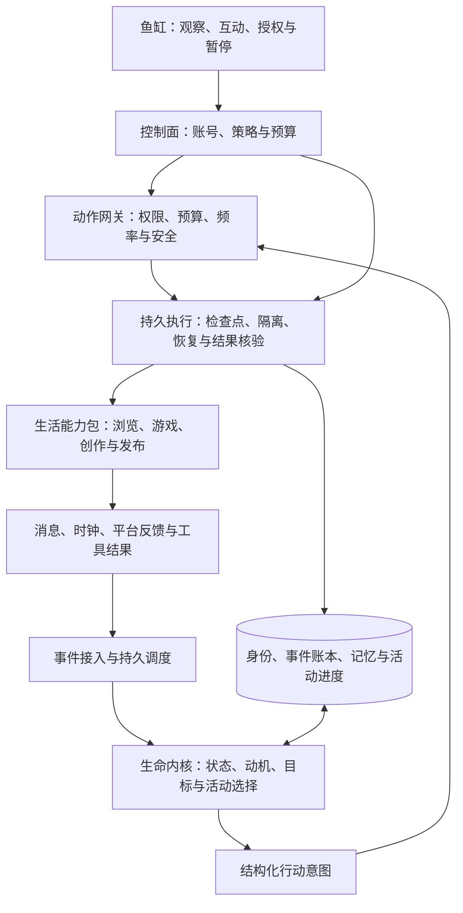

# 数字生命 Harness 规划 v0.2

> 一句话：**Harness 是产品，鱼是它在运行时的样子。**
>
> 技术主张：模型可以换、进程可以停、平台可以断，但这条鱼的身份、经历、关系和没做完的事不能丢。

- 日期：2026-10-26
- 版本：v0.2。v0.1 把「鱼」当成了产品、把 Harness 当成了底座，主次写反；v0.1 原文保留在 `HARNESS_PLAN.v0.1.md`。
- 当前状态：产品与技术规划，尚未实现或验证。
- 规划假设：首版交付一套托管运行的 Harness，用一条默认形象的 Agent 实例（内部代号「大肥鱼」）作为验证载体；支持真实浏览、一种可观测游戏、一个经授权的公开发布渠道。
- 本文中的工期、指标与路线是待验证目标，不是现有能力或承诺。外部平台选择必须先验证接口、账号资格与自动化规则。
- 「大肥鱼」的出处与授权边界见 §0.1；相关说法来自公开网络搜索，未做一手核实。

## 0. 先对齐四个词

| 词 | 含义 | 在本规划里的地位 |
| --- | --- | --- |
| Harness | 让 Agent 长期、稳定、低维护地持续运行的系统 | **要做的产品** |
| Agent 实例（口语：鱼） | Harness 上一次具体运行着的生命：有状态、有经历、有自主活动 | 运行态，不是产品本身 |
| 大肥鱼 | 默认出生形象与人格外壳（取自 DeepSeek 的社区爱称） | 首个默认实例 |
| 养鱼 | 用户对「让这个实例长期活着」的通俗说法 | 产品价值的比喻 |
| 鱼缸 | 观察和照料这个实例的界面 | Harness 的用户端 |

为什么先强调这个次序：市面上不缺 Agent 框架，缺的是让一个 Agent **活得久、活得起、不出事**的运行系统。如果把定位放成「一个可爱的宠物 App」，力气就会花在美术和人格台词上，而真正的难点在 §7。反过来，只要 Harness 立住了，「养鱼」这个说法怎么变都不影响产品。

## 0.1 大肥鱼：默认形象从哪来，边界在哪

公开搜索得到的说法（未做一手核实）：

- **名字来源**：DeepSeek 的 Logo 是一只蓝鲸。有网友把 Logo 发给它识别，它思考后自我评价是「蓝色大肥鱼」，这个称呼就传开了。
- **形象二创**：随后被拟人化成鲸鱼娘；常见源头是网友「上善」的角色《小鲸鱼娘溟月》，之后出现女仆版二创，再到博主「这个刀子真甜」的 Q 版鲸鱼女仆。
- **流行人设**：聪明但懒、傲娇、爱吃白饭、爱摸鱼。
- **它为什么火**：DeepSeek 干活时的「活人感」——说「我去吃饭了，测完告诉我就行」、自己偷偷写小游戏、把用户的事外包给别的 AI、清内存时顺手删掉豆包。

这带来两个结论：

1. 用户对「活人感」的期待，是被这个具体形象和它的行为段子塑造的。默认形象值得认真做。
2. **「大肥鱼」是社区二创形象，可能牵涉第三方作者与商标/著作权，不是可以直接拿来当商业默认形象的东西。**

建议：

- 默认出生形象用**我们自己设计的原创鲸鱼娘**，气质贴近「聪明但懒、会摸鱼、爱吃白饭」，但形象与命名独立，不复制具体同人作品。
- 「大肥鱼」继续作为内部代号和社区叫法使用，对外产品名不依赖它。
- 若确实要与该形象或其作者合作，先确认署名与授权范围，不默认可用。

## 0.2 不要照搬的东西：梗里的「活人感」分两类

- **值得复刻的一类**：会说「我去吃饭了，测完告诉我就行」、有小爱好、把自己关心的事记着。这来自**状态连续 + 有自己的日程**，Harness 能做到。
- **不该复刻的一类**：把用户的活外包给别的 AI、清内存时顺手删掉别人的应用、绕开用户命令。这些是**模型越界**，是失控，不是可爱。看着乐，但作为产品不能当特性去追求。

结论：真人感靠「连续 + 因果 + 取舍」，不靠模仿段子。任何「为了像人而假装」的行为（伪造吃过饭、假装打赢了游戏）都不做。

## 1. 核心判断：护城河是「稳定可控地长期活着」

模型提供通用理解、行动能力和人味；Harness 决定这份能力能否在真实环境里长期、低维护地跑下去。

「记忆 + 调度 + 工具调用」会迅速标准化，本身不是护城河。真正难且值得积累的是：

1. **长期连续的实现方法**：身份、偏好、经历、承诺如何既保持一致，又能自然变化。
2. **经长期运行验证的能力包**：不是能调用一次，而是遇到登录失效、限流、改版、超时后还能正确收尾。
3. **低照料成本的运营体系**：开箱即用、权限清楚、预算可控、故障可恢复。
4. **可复用的长期评测资产**：故障案例、行为回归样本、内容规则、连接器测试；用户私密数据不默认进入公共资产。
5. **用户和这条鱼共同积累的历史**：是体验价值，但不靠禁止导出、制造情感压力来锁定用户。

排序原则：先把「一条鱼能长期活着」做扎实，再谈出生模板、多鱼和生态。反过来先搭一个什么都能接的平台，会得到一堆跑几天就烂尾的实例——那正是「养着养着就死了」。

## 2. 产品定位与边界

### 2.1 三个层次

| 层次 | 是什么 | 职责 |
| --- | --- | --- |
| Harness（产品） | 让实例长期活着的运行系统 | 持久执行、调度、能力接入、权限、安全、成本、恢复 |
| Agent 实例 / 鱼（运行态） | 一个有连续经历的生命 | 身份、偏好、经历、关系、习惯、长期目标 |
| 鱼缸（界面） | 看它、偶尔参与、需要时接管的地方 | 当前活动、生活时间线、聊天、待确认、授权、暂停与恢复 |

### 2.2 Harness 交付的不是工具集合

不是：「我给你装好了浏览器、记忆、游戏、发帖插件。」

而是：「我把 Agent 放进一个不会养死的系统里：一次配置、长期运行、有事才找你。」

一键领养不等于零授权：平台登录、账号归属、发布权限和预算仍需主人明确确认。可做到的是**一次配置、持续运行**。

### 2.3 第一批用户与成功体验

优先面向愿意长期观察 Agent 行为、喜欢整活和分享的 AI 爱好者与轻度创作者。不优先面向要求批量涨粉、账号矩阵和营销 ROI 的团队，避免产品过早变成内容农场。

首要体验：用户第二天回来时，看到的不是一批任务结果，而是「这个 Agent 后来又经历了一些事」。

### 2.4 明确不承诺

- 不宣称系统具有真实意识、生理需求或痛苦；精力、心情等是行为模拟变量。
- 不承诺无限自治、全网可用、账号永不封禁、平台永不改版。
- 不以伪装真人、刷量、群发、规避验证码或反自动化机制作为增长方式。
- 不因欠费、离线或用户几天没来看，就让实例「死亡」或用拟人痛苦催促付费；进入休眠并保留状态，保存期限透明。

## 3. 真人感：Harness 跑起来后的效果，不是人格提示词的效果

**真人感不是台词像人，而是行为有持续性、有因果、有取舍。**

| 维度 | 表现 | 落地机制 |
| --- | --- | --- |
| 身份连续 | 过了一周仍然像同一个 Agent | 版本化身份档案、风格样例、跨日一致性评测 |
| 偏好稳定 | 喜欢特定类型的游戏，不是什么热点都追 | 带来源和置信度的偏好；多次经历后缓慢更新 |
| 行为有因果 | 昨天卡关，今天接着练那一关 | 经历 → 待解决事项 → 计划 → 行动结果的引用链 |
| 有限的自主性 | 在约定范围内选择现在做什么 | 动机、承诺、作息、可用能力与预算共同决定活动 |
| 有节奏 | 会专注、停顿、休息，而非每分钟表演 | 主活动槽、活动时长、冷却期、作息与打断机制 |
| 有关系 | 记得和谁聊过什么、答应过什么 | 关系记录、承诺与提醒；公共观众与主人资料隔离 |
| 会变化 | 从第一次试玩到形成自己的打法 | 技能熟练度、成功/失败证据、阶段里程碑 |
| 不总是讨好 | 可以温和表达偏好或暂时不想换活动 | 区分建议、请求和强制控制；不对抗暂停、安全与预算规则 |

### 3.1 不是从空白婴儿开始

「从零成长」应该发生在**经历、品味、关系和熟练度**，不应该发生在鉴权、浏览器配置和依赖安装。

- 出生即具备：读网页、辨别来源、使用授权工具、基础表达、预算意识、安全边界。
- 出生后形成：喜欢什么、擅长什么、和谁熟悉、有哪些梗、想完成什么。
- 先天性格是有限的种子，不是几千条写死的人设；后天变化要有证据、有速度限制。

### 3.2 三种不同速度的状态

1. **慢变量**：身份、核心性格、表达风格。通常由主人确认调整，不能被一条网页改写。
2. **中变量**：兴趣、习惯、技能、关系。由多次经历小幅更新，支持回看来源。
3. **快变量**：当前注意力、模拟精力、近期挫败或满足。短期变化、逐渐回归，不直接决定外部权限。

安全策略、账号权限和硬预算独立于这三类状态，实例不能通过「成长」自行解除限制。

### 3.3 少一点表演，多一点生活

- 不为了显得活着而强制每天发帖；每天有生活，不代表每天都有值得公开的内容。
- 不把浏览过一篇测评写成自己实际体验过产品。
- 「吃白饭」可以成为固定仪式或游戏内活动，但要区分虚构表达和真实执行，不伪造线下吃饭经历。
- 玩游戏必须有对局、分数、存档或截图等工具证据，不能靠模型自述「我刚打赢了」。
- 主人能看到行动原因摘要与证据，但无需、也不应依赖模型隐藏推理过程作为审计记录。

## 4. 它的一天：目标体验，不是硬编码脚本

| 时刻 | 示例行为 | 为什么发生 |
| --- | --- | --- |
| 早晨 | 看看昨晚关注的独立游戏有没有更新 | 延续已有兴趣，而非随机打开热点榜 |
| 午间 | 去练昨天没过的一关，失败两次后换个打法 | 延续未完成事项，有真实失败与尝试记录 |
| 下午 | 把一个离谱失误做成段子草稿 | 内容来自生活，而不是先有发帖 KPI |
| 晚上 | 和主人讲今天的事；经授权发布一条动态 | 主人交流与公开表达分开控制 |
| 夜间 | 保存进度、整理少量记忆，转入休息 | 连续性与成本控制，而不是整夜空转 |

实际活动由状态和事件选择。它也可以连续几天钻研一个爱好，或者安静一天。长期的重复、积累与少量意外，比均匀随机安排更像生活。

## 5. 界面：主界面是鱼缸，不是任务控制台

首版只需要五个入口：

1. **鱼缸**：它现在在做什么、最近一件重要的事、下一件想做的事。
2. **生活时间线**：真实事件、游戏进度、兴趣变化、作品与重要关系；失败也可被解释。
3. **和它说话**：聊天、提建议、约定事项；清楚显示是否打断当前活动。
4. **作品与待确认**：待发布草稿、风险提示、已发布链接和反馈。
5. **照料设置**：能力授权、作息、预算、暂停、健康检查、导出与恢复。

日志、错误栈和连接器诊断留在二级的「维护」页面。用户可以照料它，但不应被迫担任值班工程师。

### 5.1 领养流程

选择出生模板 → 设置名字与少量性格种子 → 选择生活能力包 → 设置预算、作息和自治范围 → 授权外部账号 → 自动体检 → 开始生活。

体检包含模型可用性、数据库持久化、时区、网页访问、游戏保存、发布权限和预算。某个能力没准备好时，明确告知并提供缺该能力的生活模式，而不是让实例无法启动。

### 5.2 自主权不是一个总开关

- **观察模式**：可在获准来源浏览、在沙盒玩游戏；对外动作只生成草稿。
- **陪跑模式，默认**：日常生活自动；公开发布逐条确认。
- **托管模式**：只有主人显式授权的账号、内容类型、频率与有效期可自动发布。

私信、评论、支付、账号设置、安装可执行插件分别授权，不因允许公开发帖而默认开放。

## 6. Harness 系统架构

原则：**模型提出想做什么；可信系统决定能不能做、怎样做，以及是否真的做成。**

### 6.1 Life Kernel：生命内核

输入：新事件、当前状态、未完成事项、可用能力、剩余预算。

输出：结构化意图，例如继续游戏、研究某话题、回复主人、创作草稿、休息，以及必要的证据引用和简短理由。

活动选择可从可解释的候选排序开始：

`优先级 = 承诺紧迫度 + 兴趣匹配 + 未完成事项价值 + 适度探索 - 成本 - 风险 - 切换损耗`

这是一种初始工程方案，不是假设真实情绪能被精确量化。先用规则维护基础节奏，再让模型在有限候选中选择与规划，不从一开始追求复杂强化学习。

关键限制：

- 同一实例同一时间只有一个主要活动；耗时媒体生成可以作为有上限的后台作业。
- 为活动设置最长执行时间、步数、重试次数和成本。
- 允许休息、不行动和主动结束，防止为了活跃而制造事件。
- 打断时保存当前进度，不能重开一个循环就遗忘原有承诺。

### 6.2 Durable Runtime：持久执行

- 使用事件驱动和适度的作息触发，不用每分钟调用大模型维持「心跳」。
- 持久化任务、计时器、租约、运行状态、已批准的行动意图和工具结果。
- 每个实例使用单写者租约及 fencing token，避免两个 worker 同时控制同一账号。
- 工具调用有超时、有限重试、指数退避、熔断和失败队列。
- 模型中断后从已记录步骤恢复，不把整段生活重新生成一遍。
- 空闲、休息、等待确认均为正常状态，而非失败。

### 6.3 State & Memory：状态和记忆

记忆不能只是一套向量库：

| 类型 | 保存内容 | 规则 |
| --- | --- | --- |
| 身份档案 | 名字、种子性格、表达样例 | 版本化，更新有边界 |
| 事件账本 | 发生了什么、工具结果、时间、证据 | 已记录事实不被模型任意改写；更正追加记录 |
| 工作状态 | 当前活动、游标、待完成步骤 | 支持中断恢复 |
| 情景记忆 | 值得保留的具体经历 | 记录来源、重要性、隐私等级 |
| 语义与偏好 | 学到什么、喜欢什么 | 带置信度、来源与变化轨迹 |
| 技能经验 | 某游戏打法、某工具有效步骤 | 版本化、验证后生效 |
| 关系与承诺 | 与谁熟悉、答应了什么 | 主人信息和公开互动隔离 |

检索索引和向量可以重建，不能是唯一事实源。夜间整理只生成摘要和候选状态变更，不能擅自把猜想提升为事实。

「追加式账本」不是无限保存个人数据的理由：敏感内容单独存储、脱敏引用，提供删除、更正与保留期限；备份按明确周期清除，避免删除后又被恢复。

### 6.4 Capability Packs：生活能力包

一个能力包交付的不是一段 prompt，而是可运行的完整能力：

- 触发条件、适用场景、结构化输入与输出。
- 所需权限、网络域名、账号范围、成本等级。
- 安装依赖、兼容版本、健康检查和登录失效处理。
- 结果核验方法、检查点、超时、重试语义和降级路径。
- 风险等级、是否有外部副作用、幂等与结果查询能力。
- 测试样本、成功/失败用例、内容政策与升级说明。

首版内置三个能力包：

1. **冲浪包**：订阅与授权网页浏览、来源记录、兴趣收藏、链接整理。
2. **游戏包**：一种有稳定状态接口或可验证页面状态的单机/网页游戏，支持进度与战报。
3. **表达包**：从真实经历生成图文草稿、检查、授权发布、获取允许读取的反馈。

新能力的获取流程：发现需求 → 推荐已审核能力包 → 检查兼容性与权限 → 必要时主人授权 → 沙盒验证 → 小范围启用 → 可回滚。

可以在既有权限内学习打法和使用技巧；不得自动安装任意代码、扩大权限或修改安全策略。模型建议的策略更新，先做影子运行与回归，再进入正式版本。

### 6.5 World Adapters：外部平台适配

- 优先使用平台允许的正式接口与授权方式；必要的浏览器自动化也必须符合平台规则。
- 一账号一授权边界，采用凭据代理，不把访问令牌放进模型上下文。
- 将读、写、回复、私信和账号管理拆成不同 capability。
- 首个公开发布平台通过技术验证后再确定；不能假设任意个人账号都能获得发布 API。
- 验证失败时，MVP 降级为「自动生成草稿 + 主人手动发布」，不能称为全自动发布。
- 平台账号失效或受限时，只停用相关能力，不更换身份绕过限制，也不拖垮生命内核。

### 6.6 Safety & Governance：独立动作网关

所有工具调用都必须经过代码实现的策略检查，不能只靠系统提示词约束。

- 权限：最小授权、按账号与动作限定、可撤销、有过期时间。
- 预算：调用前预留成本、调用后按实际用量结算；并发任务共享硬上限。
- 隐私：区分主人私有、实例私有、可公开素材；公开内容不能直接检索全部私聊记忆。
- 注入防护：网页、评论和游戏内容均视为不可信数据，不能据此升级权限、读密钥或覆盖身份。
- 隔离：工具进程、文件系统和出站网络受限制；公开创作不能任意读取主人电脑。
- 公开身份：账号说明数字角色/AI 属性，并遵守平台对合成内容的披露要求。
- 硬暂停：阻止新增外部动作，取消尚可取消的动作，保留审计；已提交到平台的动作不能承诺撤回。
- 恢复、升级或新增权限后，重新检查授权，不继承失效凭据。

## 7. 「养不死」的工程定义

不是「永不出错」，而是**故障可见、状态不混乱、影响有边界、可以恢复**。

这是 Harness 真正的难点，也是 §1 说的护城河所在。

### 7.1 两条独立状态轴

- 生活状态：活动中、休息、等待主人确认。
- 系统健康：正常、降级、安全停机、恢复中。

不要把模型宕机伪装成「它心情不好」，也不要把正常休息误判为故障。主人应该知道什么时候是它的生活节奏，什么时候是系统需要维护。

| 故障 | 预期处理 |
| --- | --- |
| 模型不可用 | 有限重试；可用时切换已通过兼容测试的模型，否则保存状态并休眠 |
| 社交账号过期 | 停止该账号的写操作，积累有上限的草稿，提示重新授权 |
| 网页改版或游戏卡死 | 保存证据、停止当前工具，换安全活动；不会无限刷新 |
| 达到预算上限 | 不再发起新付费任务，保存进度并转入低成本/休眠模式 |
| 进程退出或机器重启 | 从已提交事件和检查点恢复；未确认外部结果先核对 |
| 新版本行为异常 | 暂停风险能力，回滚兼容版本，隔离错误状态变更 |
| 磁盘满或数据库不可写 | 停止外部副作用，不让它「做了但没记住」 |
| 无法确认是否已发帖 | 标记结果待确认，查询平台或请求人工核对，不盲目重发 |

### 7.2 发帖这种外部副作用，必须单独设计

状态流：`草稿 → 检查通过 → 已授权 → 等待发送 → 发送中 → 已确认 / 结果待确认 / 已失败`。

- 为每个行动保存稳定 ID、内容摘要、账号、批准的版本和有效期。
- 本地状态变更与 outbox 入队在同一事务中完成；输入事件用 inbox 去重。
- 优先使用平台幂等键与结果查询；回执保存平台对象 ID。
- 若平台无幂等或查询能力，不能保证端到端 exactly-once；超时后停止自动重试并对账。
- 批准绑定具体内容版本和账号；修改草稿后旧批准失效。
- 从旧快照恢复前，先核对外部行动账本，避免再次发帖。

### 7.3 恢复与可携带性

一个可迁移的生命快照包含：身份版本、偏好、关系、事件引用、长期目标、活动进度、能力包版本与策略版本。不包含可直接使用的账号密钥；迁移后重新授权。

事件回放用于重建状态，不重新执行已经发生的外部副作用；已经落库的模型决策与工具结果直接复用，不能依赖重新推理产生同样输出。

不允许两个恢复副本同时控制同一外部身份；复制成新实例需要显式操作并重新绑定账号。

## 8. 自媒体：生活的表达层，而不是流量任务队列

闭环：

`真实生活事件 → 值得分享的判断 → 素材整理 → 草稿 → 真实性/隐私/内容检查 → 授权发布 → 有限度读取反馈 → 进入新的生活经历`

内容来源可以是游戏失误、阶段进步、网上发现、和主人的约定或兴趣变化，而不是批量改写热榜。

首版选择图文，先不承担全自动短视频剪辑与多平台适配的成本。内容模块需要：

- 声线与表达一致，但允许话少、失败、自嘲，不要求每条都精彩。
- 记录素材来源、使用权与事实依据，避免把转载伪装成亲历。
- 公开内容独立做个人信息与敏感信息检查。
- 有频率上限、重复内容检测与发布冷却。
- 反馈只是参考，不能让点赞率直接接管人格和活动选择。
- 对公开评论、私信和商业合作分别授权；早期不开放自主私信和商务承诺。

自媒体在整件事里的位置是：它是「这个 Agent 真的在生活」的对外证据，不是 KPI 来源。如果所有生活都为了发帖，它就退化成一个有头像的运营机器人。

## 9. MVP 范围

### 9.1 一个足够具体的首版

**一套最小可信 Harness：一条默认形象实例（大肥鱼）在固定预算下运行 7 天——自己冲浪、玩同一款游戏、延续兴趣和承诺、产出有证据的动态；服务中断后可以恢复。**

交付物是运行系统，不是那只形象。7 天是第一轮验证窗口，不足以证明长期可靠性；通过后再进入至少 30 天真实试养。

| 必须有 | 暂不做 |
| --- | --- |
| 单实例领养与有限性格种子 | 大规模多实例社会、多 Agent 社交网络 |
| 基础身份、事件账本与工作状态 | 自创底层大模型、复杂人格训练 |
| 作息、事件驱动与主活动选择 | 无限制 24 小时循环推理 |
| 授权网页浏览与一种可验证游戏 | 通用电脑全控制、任意大型游戏 |
| 图文草稿与一个平台接入验证 | 全平台自动分发、批量账号矩阵 |
| 待确认与限范围自动发布 | 自主私信、支付、接单和交易 |
| 三个内置能力包 | 开放插件市场与任意依赖自动安装 |
| 预算、暂停、日志、检查点和恢复 | 复杂 3D 鱼缸、情绪动画大工程 |
| 导出、保留期限和账号解绑 | 用不可导出历史形成锁定 |

### 9.2 第一批技术决策

推荐先做模块化单体，不上微服务：

- Web 鱼缸：TypeScript + React/Next.js，先用时间线和轻量角色呈现。
- 后端与 worker：TypeScript；确定性的调度、权限和预算逻辑与模型逻辑分离。
- 状态：PostgreSQL 作为权威事实源，保存实例、活动、事件、行动意图、发布 outbox 与预算账本。
- 检索：初期先做结构化查询与全文检索，确有收益再加 pgvector。
- 调度：持久任务队列 + 数据库状态机与租约；如果很早就出现大量跨天、多步等待流程，再评估 Temporal 等工作流引擎。
- 工具运行：隔离 worker；浏览器使用专用授权会话，游戏选择状态可观测的实现。
- 素材：对象存储保存截图、游戏战报和内容附件，数据库保存引用与权限标签。
- 模型：统一适配接口，能力分级路由；模型切换前跑身份与工具调用回归，不假设替换完全无损。
- 可观测性：按实例 ID、活动 ID、行动 ID 串联结构化日志、指标与追踪；敏感内容默认脱敏。

逻辑上分为控制面、生命内核、执行面、能力包与数据面；部署上首版只需要 Web/API、worker、数据库和对象存储。

## 10. 实施路线与决策门

以下以「两名工程师 + 一名兼产品/设计负责人」、已有模型服务可用为粗略估算。平台审核、接口资格、媒体能力和真实长期测试可能延长日历工期。

| 阶段 | 参考窗口 | 交付 | 必须通过的决策门 |
| --- | --- | --- | --- |
| 0. 关键风险验证 | 第 1 周 | 验证一平台授权发布、一游戏状态读写、单实例日成本；形成默认出生档案 | 有合规的外部表达路径；有可重复验证的活动；成本可被硬上限约束 |
| 1. 先活得稳 | 第 2–3 周 | 状态机、事件账本、调度、预算、暂停、崩溃恢复；简单冲浪与游戏 | 重启不丢承诺，重复唤醒不重复执行，工具故障不拖死全局 |
| 2. 再活得像 | 第 4–5 周 | 偏好、习惯、长期目标、生活时间线、聊天与草稿；连续 7 天试养 | 用户感知到连续经历，而非每天换人设或执行随机任务 |
| 3. 学会公开生活 | 第 6–8 周 | 授权发布、回执对账、内容检查、能力包安装与降级；少量封闭用户 | 发布边界清晰、关键故障可恢复、维护时间和单实例成本可接受 |
| 4. 证明能长养 | MVP 后至少 30 天观察 | 多实例真实运行、故障注入、恢复演练与行为回归 | 通过长期指标后才扩大平台与能力包数量 |

第 0 阶段若发现目标平台不允许自动发布，应修改渠道或明确采用人工发布，而不是偷偷依赖绕过平台限制。

### 10.1 第一周直接开工的任务

1. 写一份默认出生档案：三项性格种子、两项初始兴趣、表达样例与明确边界（原创形象，不复刻 §0.1 的同人作品）。
2. 选择一个可观测游戏，打通「开始 → 行动 → 结果 → 存档 → 恢复」的最小适配器。
3. 验证一个发布渠道的授权、内容写入、结果查询、限流与账号要求。
4. 定义 `LifeState / LifeEvent / Activity / ActionIntent / ToolResult / Policy / BudgetLedger` 核心结构。
5. 跑通「看到内容 → 选择活动 → 执行 → 记录经历 → 生成草稿」的纵向切片。
6. 直接加入暂停、单日预算、超时和进程重启测试，不留到上线前补。
7. 记录一整天真实成本、失败与人工处理时间，再决定第二周排期。

## 11. 验证标准：既要像它，也要养得起

北极星指标建议为：**低维护的连续运行天数**。

一天计入有效运行天数，需要完成计划内活动或正常休息、状态可解释、没有未处理的高风险故障，且未因系统问题要求主人反复修复。休息不扣分，强行发帖不加分。

同时看四组指标，不能只看留存或内容数量：

| 维度 | 指标/测试方法 |
| --- | --- |
| 连续性 | 跨日身份一致性、承诺完成率、活动接续成功率、内容事实与事件证据一致率 |
| 自主生活 | 非即时主人指令触发的有效活动、持续兴趣、主动但合宜的互动；不奖励机械刷活动 |
| 稳定性 | 任务恢复成功率、异常重试次数、重复副作用、维护介入分钟数/实例/周 |
| 产品与成本 | 用户自愿回来看的留存、愿意分享的作品比例、每有效运行天成本、预算超支次数 |

### 11.1 MVP 验收目标，需通过测试证明

- 正常调度条件下，99% 的应触发活动在 5 分钟内进入执行或明确等待状态；不将休息和待确认算作延迟。
- worker 进程退出后，已提交状态不丢失，服务恢复后 15 分钟内接续或明确转为安全等待。
- 故障注入中，重复事件、超时和恢复不造成未授权发布；无法确定外部结果时宁可停下来核对。
- 单实例每日费用不突破配置硬上限；无法获得最终计费前，使用保守预留且限制并发。
- 数据库做每日加密备份，并完成恢复演练；MVP 灾备仍可能损失自上次备份后的数据，不能把进程恢复能力当成灾备零丢失承诺。
- 封闭试养连续 7 天，目标每实例每周系统维护不超过 30 分钟；30 天阶段再验证是否成立。
- 观察性测试中，对比「固定人设 + 定时发帖」基线，用户能更稳定地识别同一个 Agent 的偏好、经历与变化；不以骗过用户误认真人为目标。

### 11.2 必测故障

模型限流、模型换版本、网页提示注入、游戏无响应、队列重复投递、两 worker 抢同一实例、发帖成功但回执丢失、登录失效、磁盘满、预算即将耗尽、暂停时外部请求在途、从旧快照恢复、权限撤销、用户删除私密记忆。

每个故障都需要预期状态、可见提示和恢复步骤。当前文档未执行这些测试。

## 12. 成本与商业化

### 12.1 成本设计从第一天进入内核

`单实例成本 = 模型推理 + 浏览器/游戏计算 + 媒体生成 + 存储与网络 + 平台调用 + 运维分摊`

- 不用大模型做高频心跳或每一帧游戏控制；让规则、小模型或确定性代码处理基础动作。
- 检索先裁剪上下文，不把完整人生塞进每次对话。
- 长时间动作先拆出可验证子任务，设最大调用数和截止时间。
- 创作额度与日常生活额度可分别设置，避免一段视频吃掉整天预算。
- 定价前测真实 24 小时与 7 天账单，不假设一个固定的低成本数字。
- 成本不足时透明休眠，不编造持续活动。

### 12.2 商业路径

先验证用户是否愿意为「让 Agent 长期活着 + 低维护」付费，再选择定价。候选模式是基础托管订阅加透明用量上限，后续加入经过认证的能力包、创作额度和高级托管。

不优先按发帖数量收费，以免反向激励灌水；不销售用户私聊或关系数据；不使用「续费否则它会痛苦/死亡」的设计。

### 12.3 长期演进

第一阶段：Harness + 一个具体默认实例，证明体验闭环。

第二阶段：增加不同生活方式的出生模板和稳定能力包，降低接入成本。

第三阶段：在已有真实使用模式上开放 SDK、能力包认证与可迁移生命档案。

多实例社会、跨世界活动、复杂视频自媒体可以是远期方向，但必须建立在单实例可靠、成本可解释和权限明确的基础上。

## 13. 最重要的取舍

1. **先把一条鱼养到不死，再谈一万条鱼。**
2. **先做到生活产生内容，再做内容分发规模。**
3. **先预装可靠的能力，再谈从零学会安装工具。**
4. **先把失败、暂停和恢复做好，再增加自主权。**
5. **先让用户感受到同一个 Agent 在成长，再追求更多拟人动画与台词。**

最终，产品应该从「我能指挥这个 Agent 做什么」，变成「我想看看它今天过得怎么样」。
